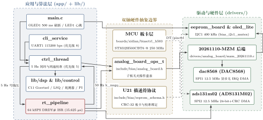

# 系统架构

## 系统总体架构与双轴可扩展原则

工程采用 **数字控制底板 + 可替换模拟子板** 分板架构，通过两条正交抽象边界实现解耦（遗留单板硬件明确不纳入兼容范围）：

1. **MCU 轴可扩展性**：主控相关时钟树、引脚复用与 DMA 分配全部封装在 `boards/xidian/<board>/`，更换主控 MCU 时无需改动 `drivers/`、`lib/` 与 `app/`。
2. **模拟子板轴可扩展性**：所有偏压范围、跨阻增益与导频路由表均通过 `analog_board_ops_t` 接口与子板 `U21` EEPROM 描述符动态描述。

---

## 实时调度、中断隔离与故障安全模型

`64 kSPS` 周期仅有 **`15.625 µs`**（`3906` 个 CPU 周期 @ `250 MHz`），软件严格隔离实时中断路径与慢速外设线程：

| 执行上下文 | 职责 | 实时与安全约束 |
| --- | --- | --- |
| **`DRDY#` EXTI + DMA RX 回调（[rt_pipeline.c](../app/src/rt_pipeline.c)）** | 1. 接收 `ADS131M02` `CH0/CH1` 帧并校验 CRC； 2. 生成下一步 `DITHER1` 码字，在计算前提交 `SPI1` 传输以掩盖总线延迟； 3. 更新 `1 kHz / 2 kHz` Goertzel 与 `CH1` 直流累加器； 4. 在 `8 µs` 轮询窗口后执行最多 1 次 `dac8568_set_dc_code_async()`（`5 Hz` `VA` 偏压更新）； 5. 每 `1280` 点打包投递 `rt_pipeline_blocks` `k_msgq`（深度 10，`50 Hz`）。 | 运行期间 **`DRDY#` ISR 独占 `SPI1` 与 `SPI2`**，采用无 DMA 中断寄存器轮询与单精度 `goertzel_result_fast()`；严禁调用 `I2C`、`UART`、互斥锁或休眠；任何 CRC 错误、SPI 超时或队列满立即调用 `trip()` 进入 `FAULT`。 |
| **`ctrl_thread`（优先级 `5`，栈 `2560 B`，[ctrl_thread.c](../app/src/ctrl_thread.c)）** | 以 `DSP_CONTROL_DECIMATION = 10` 抽取 `rt_pipeline` 块，组成 `0.2 s`（`5 Hz`）控制周期：驱动两遍 `cal bias` 状态机或 `ctrl_mzm_strategy` PI 闭环更新，并检查序号连续性与幅度一致性。 | 通过 `rt_pipeline_set_dc_code()` 同步握手委托 ISR 发包；出现任何错误即调用 `shutdown()` 切断导频路由、停止采样并把 `VA` 复位到 `0 V`。 |
| **`cli_service`（优先级 `8`，栈 `2048 B`，[cli_service.c](../app/src/cli_service.c)）** | UART 中断收字节写入 `128 B` 环形队列，线程内行解析与 `status` 打印。 | 全异步接收，不阻塞 `DRDY#` 与控制线程。 |
| **`main` 低优先级循环（[main.c](../app/src/main.c)）** | 每 `500 ms` 差分刷新 `OLED1`（仅数据行变化时写 `I2C1`），驱动 `LED1` 正常 500 ms / 故障 150 ms 翻转。 | 通过 `bias_i2c1_mutex` 与 `U21` 读写互斥；与实时流水线无共享阻塞锁。 |

---

## `U21 (P24C02A, 256 B)` EEPROM 存储分区

描述符与记录的序列化定义见 [EEPROM 描述符](../include/bias/eeprom_schema.h) 和 [校准存储服务](../app/src/cal_service.c)。

| 地址范围 | 大小 | 结构体 / 内容 | 校验与绑定规则 |
| --- | :---: | --- | --- |
| `0x00 .. 0x93` | `148 B` | `struct bias_eeprom_descriptor_v1`（magic `0x53414942` `"BIAS"`，version `1`，`board_id="20261110-MZM"`，`tia_gain_ohms=47000`，`6` 通道增益/偏置/`vpi_uv`） | 尾部 `4 B` `CRC-32/ISO-HDLC`，由 `eeprom init` 或校准保存写入 |
| `0x94 .. 0x9F` | `12 B` | 保留页对齐间隔 | — |
| `0xA0 .. 0xD7` | `56 B` | `struct cal_mzm_record_v1`（magic `0x314D5A4D` `"MZM1"`，`descriptor_crc`，`dsp_affine_fit_t fit`，`null_v`，`vpi_v`，`cal_pilot_v`，`obs_dc_seed`，`has_obs_dc_seed`） | 尾部 `4 B` `CRC-32/ISO-HDLC`，且 `descriptor_crc` 必须匹配当前描述符 CRC |
| `0xD8 .. 0xFF` | `40 B` | 预留扩展区 | — |

---

## 当前资源占用与实测性能基线（Phase 4 终版）

- **内存与存储（硬预算：Flash `<= 110,592 B`，RAM `<= 24,576 B`）**：
  - `zephyr.elf`：`text=79,576 B, data=1,152 B, bss=14,662 B`
  - **Flash**：**`80,728 / 110,592 B`（73.0%）**，剩余 `29,864 B`
  - **静态 RAM**：**`15,814 / 24,576 B`（64.3%）**，剩余 `8,762 B`
- **自动化验证**：7 个核心 C 文件 `-Wall -Wextra -Werror` `0` 警告；QEMU `ztest` `5/5 PASS`；Host CTest `13/13 PASS`。
- **真机光学闭环实测（[phase4-closed-loop-verify.md](experiments/bringup/phase4-closed-loop-verify.md)）**：
  - `Vpi = 5382 mV`，`null = -3029 mV`；掉电复位重载 `ctrl_thread init: 0`；
  - `QUAD(90)` `dc=418.561 mV`（`53.2%`），`MAX(180)` `dc=787.601 mV`（`100.0%`），`MIN(0)` `dc=-0.992 mV`（`0.0%`），`CUSTOM(135)` `dc=678.135 mV`（`86.1%`），全过程 `drops=0, crc_errs=0, fault=0`。

---

## Phase 5 架构演进规划（适配无开关固定双导频实板）

依据修订后的 [05-tdm-multichannel-and-ui](../openspec/changes/05-tdm-multichannel-and-ui/design.md)，后续演进围绕三部分展开：
1. **`p5_tdm_scheduler`（单 MZM 无缝切换 + 无开关 DPMZM 固定双导频）**：
   - 运行态 `QUAD <-> MIN <-> MAX <-> CUSTOM` 动态切点不中断实时流，按连续相位跟踪重算半周期边界与观测器锚点；
   - 基于固定飞线（`DITHER1 -> VA` 调制子臂 I、`DITHER2 -> VC` 调制子臂 Q、`VB` 纯直流控制主臂、提取 $f_1 \pm f_2$ 互调分量）实现 `ctrl_mod_dpmzm`，在 `64 kSPS` 下采用整周期正交频率组合并满足 `15.625 µs` ISR 时序裕量，通过宿主机 3 臂光学闭环仿真（误差 `< 1.0 deg`）。
2. **`p5_ui_oled_dial`（本地 `OLED1` + `WS-001CB` 拨轮 UI）**：
   - 在最低线程优先级（栈 `<= 1.5 KiB`）实现 `app/src/ui_service.{c,h}`，完成状态监控与免串口切换目标/启停/校准/保存，保持 `drops == 0`。
3. **`p5_full_system_verify`（整机系统联调与资源验收）**：
   - 完成固件集成，确认新增代码后仍满足 `Flash <= 110,592 B` 与 `RAM <= 24,576 B`，通过真机与全量回归验收。

---

## 文档变更记录

| 日期 | 版本 | 修改内容 | 对应阶段/任务 |
| --- | --- | --- | --- |
| 2026-11-26 | v1.0 | 新建系统设计文档，完整梳理分板架构、硬件信号链与实板改造基线、64 kSPS ISR 隔离、DSP/控制算法、U21 分区、Phase 4 实测基线及 Phase 5 演进规划 | Phase 4 收尾 / Phase 5 规划同步 |
| 2026-11-26 | v1.1 | 按光学、电气、算法及 PCB 勘误拆分设计资料，归档三份验证报告。 | Phase 6 文档重组 |
| 2026-11-26 | v1.2 | 新增外壳与机械装配文档，导入物理/仿真图表，将架构图替换为 LaTeX TikZ 矢量 SVG。 | Phase 6 图形与结构补全 |
