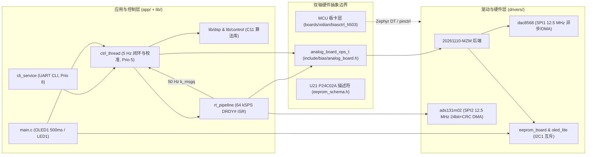

# biasctrlaio 系统设计文档

本文档记录 `biasctrlaio` 嵌入式偏压控制器的硬件抽象、实时调度、DSP 与控制算法及存储结构设计，作为代码开发与版本演进的基准技术文档。

---

## 1. 系统总体架构与双轴可扩展原则

工程采用 **数字控制底板 + 可替换模拟子板** 分板架构，通过两条正交抽象边界实现解耦（遗留单板硬件明确不纳入兼容范围）：

1. **MCU 轴可扩展性**：主控相关时钟树、引脚复用与 DMA 分配全部封装在 `boards/xidian/<board>/`，更换主控 MCU 时无需改动 `drivers/`、`lib/` 与 `app/`。
2. **模拟子板轴可扩展性**：所有偏压范围、跨阻增益与导频路由表均通过 `analog_board_ops_t` 接口与子板 `U21` EEPROM 描述符动态描述。

---

## 2. 硬件平台与信号链设计

### 2.1 数字底板核心资源与引脚映射（`STM32H503CBT6` LQFP48）
- **主频与资源**：片外 `8 MHz` 无源晶振（`PH0/PH1`）经 `PLL1`（`div-m=2, mul-n=125, div-p=2`）倍频至 `SYSCLK = HCLK = APB1/2/3 = 250 MHz`；片内 SRAM `32 KiB`、Flash `128 KiB`。
- **FPC2 压摆率约束**：所有跨越 `30-pin FPC2` 排线的数字引脚在 [biasctrl_h503.dts](file:///Users/ckdfs/code/biasctrlaio/boards/xidian/biasctrl_h503/biasctrl_h503.dts) 中统一强制设定为 **`low-speed`**（禁止设为 `very-high-speed`），用于抑制排线感性振铃。

| 外设/功能 | 引脚分配 | 电气与工作参数 | 源码位置 |
| --- | --- | --- | --- |
| 控制台 `USART1` | `PA9 (TX)`, `PA10 (RX)` | `115200 bps 8N1`，中断驱动环形缓冲 | [biasctrl_h503.dts](file:///Users/ckdfs/code/biasctrlaio/boards/xidian/biasctrl_h503/biasctrl_h503.dts#L100-L105) |
| 共享 `I2C1` | `PB8 (SCL)`, `PB7 (SDA)` | `400 kHz` 快速模式，`OLED1 (0x3C)` 与 `U21 (0x50)` 经 `bias_i2c1_mutex` 互斥 | [shared_i2c.c](file:///Users/ckdfs/code/biasctrlaio/drivers/eeprom_board/shared_i2c.c) |
| DAC `SPI1` (`DAC8568`) | `PA5 (SCK)`, `PA7 (MOSI)`, `PB1 (SYNC#)`, `PB2 (LDAC#)`, `PB0 (CLR#)` | `12.5 MHz`，`CPHA=1`，`GPDMA1 CH0/CH1`，全 `low-speed` | [dac8568.c](file:///Users/ckdfs/code/biasctrlaio/drivers/dac8568/dac8568.c) |
| ADC `SPI2` (`ADS131M02`) | `PB13 (SCK)`, `PB14 (MISO)`, `PB15 (MOSI)`, `PB12 (CS#)`, `PA11 (DRDY#)`, `PA12 (SYNC#)` | `12.5 MHz`，`CPHA=1`，`GPDMA1 CH2/CH3 HIGH`，`64 kSPS` `DRDY#` 下降沿触发 | [ads131m02_dma.c](file:///Users/ckdfs/code/biasctrlaio/drivers/ads131m02/ads131m02_dma.c) |
| 导频开关 GPIO | `PA0, PA1, PA2, PA3, PA4, PA6, PA15, PB6` | 推挽 `low-speed`，开机与故障时全部拉低；`PA8` 固定为低速 GPIO（禁用 `MCO1`） | [pilot_mux_gpio.c](file:///Users/ckdfs/code/biasctrlaio/drivers/pilot_mux/pilot_mux_gpio.c) |
| 本地 UI (`KEY1–3` / `LED1`) | `PB3 / PB4 / PB5`（上拉低有效），`PC13`（高有效） | 拨轮开关 `20 ms` 软件去抖；`LED1` 正常 `500 ms` / 故障 `150 ms` | [keys.c](file:///Users/ckdfs/code/biasctrlaio/drivers/oled_lite/keys.c) |

### 2.2 模拟子板（`20261110-MZM`）信号链定量关系与实板基线
1. **直流偏压链路（`DAC8568 CH0–CH5` -> `U11 OPA4192` 减法器）**：
   - `DAC8568` 使能内部 `2.500 V` 基准（输出 `0..5.000 V`，上电序列：`1 ms -> RESET(0x07000000) -> 2 ms -> REF_ENABLE(0x08000001) -> 5 ms (C46=10 uF) -> CH_ALL=32768`），通道写命令使用 `0x03 (CMD_WRITE_UPDATE)`。
   - 减法器传输关系（写入 `U21` 默认描述符）：
     $$V_{\mathrm{VA}} = 4 \left(V_{\mathrm{VOA}} - 2.500\ \mathrm{V}\right) \in [-10.000, +10.000]\ \mathrm{V}$$
     对应 `subtractor_gain_ppm = 8000000`、`subtractor_offset_uv = -10000000`，`0.000 V` 安全零点对应 DAC 码值 `32768`。
2. **交流导频链路（`DAC8568 CH6 DITHER1` / `CH7 DITHER2`）**：
   - 交流耦合后经反向比例缩放 $-R_{23}/R_{22} = -12\ \mathrm{k\Omega}/120\ \mathrm{k\Omega} = -0.10\ \mathrm{V/V}$ 叠加至 MZM 电极；DAC 满幅 `±2.500 V` 对应电极峰值 `RT_PIPELINE_PILOT_MAX_V = 0.25 V`，扫压与单 MZM 运行默认导频幅度 `SCAN_PILOT_V = 0.13 V`（对应 `U10.7` 输出 `±1.30 V` / 约 `0.919 Vrms`）。
3. **光电采样链路（`U12A` + `ADS131M02`）**：
   - `U12A` 采用反相跨阻放大（`tia_gain_ohms = 47000 Ω`）；`ADS131M02`（设备 ID `0x22`，片外 `8.192 MHz` 晶振 `X2`，OSR=128 HR 模式，`24-bit` 带 4 字 CRC，增益 `1`，满量程 `±1.2 V` -> `RT_PIPELINE_ADC_V_PER_COUNT = 1.2 / 8388608 V/LSB`）。
4. **当前原型实板硬件改造基线**：
   - 底板 `U7` 拆除并调整 `LMR51430` `R9`，由 `VSYS = 5.339 V` 直供 `+5V`；
   - 模拟子板拆除全部 4 颗 `TS5A23159`（`U14/U16/U17/U20`），改为无开关固定双导频飞线：`DITHER1 -> VA (C48.1)`、`DITHER2 -> VC (C56.1)`、`VB` 纯直流；`VF` `R56` 错焊 `1 kΩ` 暂留待修。

---

## 3. 实时调度、中断隔离与故障安全模型

`64 kSPS` 周期仅有 **`15.625 µs`**（`3906` 个 CPU 周期 @ `250 MHz`），软件严格隔离实时中断路径与慢速外设线程：

| 执行上下文 | 职责 | 实时与安全约束 |
| --- | --- | --- |
| **`DRDY#` EXTI + DMA RX 回调（[rt_pipeline.c](file:///Users/ckdfs/code/biasctrlaio/app/src/rt_pipeline.c)）** | 1. 接收 `ADS131M02` `CH0/CH1` 帧并校验 CRC； 2. 生成下一步 `DITHER1` 码字，在计算前提交 `SPI1` 传输以掩盖总线延迟； 3. 更新 `1 kHz / 2 kHz` Goertzel 与 `CH1` 直流累加器； 4. 在 `8 µs` 轮询窗口后执行最多 1 次 `dac8568_set_dc_code_async()`（`5 Hz` `VA` 偏压更新）； 5. 每 `1280` 点打包投递 `rt_pipeline_blocks` `k_msgq`（`50 Hz`）。 | 运行期间 **`DRDY#` ISR 独占 `SPI1` 与 `SPI2`**，采用无 DMA 中断寄存器轮询与单精度 `goertzel_result_fast()`；严禁调用 `I2C`、`UART`、互斥锁或休眠；任何 CRC 错误、SPI 超时或队列满立即调用 `trip()` 进入 `FAULT`。 |
| **`ctrl_thread`（优先级 `5`，栈 `2560 B`，[ctrl_thread.c](file:///Users/ckdfs/code/biasctrlaio/app/src/ctrl_thread.c)）** | 以 `DSP_CONTROL_DECIMATION = 10` 抽取 `rt_pipeline` 块，组成 `0.2 s`（`5 Hz`）控制周期：驱动两遍 `cal bias` 状态机或 `ctrl_mzm_strategy` PI 闭环更新，并检查序号连续性与幅度一致性。 | 通过 `rt_pipeline_set_dc_code()` 同步握手委托 ISR 发包；出现任何错误即调用 `shutdown()` 切断导频路由、停止采样并把 `VA` 复位到 `0 V`。 |
| **`cli_service`（优先级 `8`，栈 `2048 B`，[cli_service.c](file:///Users/ckdfs/code/biasctrlaio/app/src/cli_service.c)）** | UART 中断收字节写入 `128 B` 环形队列，线程内行解析与 `status` 打印。 | 全异步接收，不阻塞 `DRDY#` 与控制线程。 |
| **`main` 低优先级循环（[main.c](file:///Users/ckdfs/code/biasctrlaio/app/src/main.c)）** | 每 `500 ms` 差分刷新 `OLED1`（仅数据行变化时写 `I2C1`），驱动 `LED1` 心跳/故障闪烁。 | 通过 `bias_i2c1_mutex` 与 `U21` 读写互斥；与实时流水线无共享阻塞锁。 |

---

## 4. 核心 DSP 与闭环控制算法（`lib/dsp/` 与 `lib/control/`）

1. **零泄漏相干解调**：在 `64 kSPS` 与 `f0 = 1 kHz` 下选取块长 `N = 1280`（`20 ms`，恰好容纳 `20` 个 `1 kHz` 周期、`40` 个 `2 kHz` 周期），彻底消除频谱泄漏。
2. **`O(1)` 内存两遍扫描校准（`< 1 KiB` 扫描状态）**：
   - 第一遍（`256` 区间、`257` 步，每步先 `0.2 s` 稳定、再 `0.2 s` 采样，约 `103 s`）：利用 `H1` 幅值谷点估算半波电压 `Vpi` 并记录首个谷点有符号 `H2` 正交分量 `first_valley_q`。
   - **极性契约（`null_q_sign = -1`）**：实测 `20261110-MZM` 受 `U12A` 反相跨阻与 `2 kHz` 模拟/ADC 相移影响，暗谷（`MIN(0°)`）处的 `q = h2 * sin(h2_phase)` 为负（相位约 `-1.708 rad`），峰点（`MAX(180°)`）为正（相位约 `+1.433 rad`）；[ctrl_thread.c](file:///Users/ckdfs/code/biasctrlaio/app/src/ctrl_thread.c#L120-L124) 调用 `ctrl_bias_scan_begin_fit(&scan, -1)` 识别真正暗谷基准 `null_v`。
   - 第二遍（约 `103 s`）：通过 `dsp_online_lsq` 在线累计 `5×5` 正规方程并高斯消元求解偏置 `o[2]` 与 `2×2` 仿射耦合矩阵 `M[2][2]`，全程无需存储整条扫描波形数组。
3. **谐波相位观测器与防积分饱和 PI（[ctrl_observer.c](file:///Users/ckdfs/code/biasctrlaio/lib/control/ctrl_observer.c)）**：
   - 运行时先按 Bessel 比值 $J_1(m_{\mathrm{now}})/J_1(m_{\mathrm{cal}})$ 与 $J_2(m_{\mathrm{now}})/J_2(m_{\mathrm{cal}})$ 缩放 `M` 行向量再求逆；
   - 单位圆归一化 `[obs_x, obs_y]` 以消除光强与 RF 功率波动影响；
   - `CH1` 直流均值不混入主相位环，利用 $\sin^2(\phi_{\mathrm{target}})$ 电压弹簧项与快速 `obs_dc` EMA（`alpha = 0.50`）抑制偏置邻周期吸引域偏差；
   - 需同时满足 `bias_ok`、`observer_ok`、`radius_ok >= 0.10`、`error_ok`（`< 0.20/pi`）、`phase_ok`（目标半球）才置位 `locked=1`，连续 `25` 拍激活 `hold_assist_active`。

---

## 5. `U21 (P24C02A, 256 B)` EEPROM 存储分区

| 地址范围 | 大小 | 结构体 / 内容 | 校验与绑定规则 |
| --- | :---: | --- | --- |
| `0x00 .. 0x93` | `148 B` | `struct bias_eeprom_descriptor_v1`（magic `0x53414942` `"BIAS"`，version `1`，`board_id="20261110-MZM"`，`tia_gain_ohms`，`6` 通道增益/偏置/`vpi_uv`） | 尾部 `4 B` `CRC-32/ISO-HDLC`，由 `eeprom init` 或校准保存写入 |
| `0x94 .. 0x9F` | `12 B` | 保留页对齐间隔 | — |
| `0xA0 .. 0xD7` | `56 B` | `struct cal_mzm_record_v1`（magic `0x314D5A4D` `"MZM1"`，`descriptor_crc`，`dsp_affine_fit_t fit`，`null_v`，`vpi_v`，`cal_pilot_v`，`obs_dc_seed`，`has_obs_dc_seed`） | 尾部 `4 B` `CRC-32/ISO-HDLC`，且 `descriptor_crc` 必须匹配当前描述符 CRC |
| `0xD8 .. 0xFF` | `40 B` | 预留扩展区 | — |

---

## 6. 当前资源占用与实测性能基线（Phase 4 终版）

- **内存与存储（硬预算：Flash `<= 110,592 B`，RAM `<= 24,576 B`）**：
  - [zephyr.elf](file:///Users/ckdfs/code/biasctrlaio/build/h503_p4/zephyr/zephyr.elf)：`text=79,576 B, data=1,152 B, bss=14,662 B`
  - **Flash**：**`80,728 / 110,592 B`（73.0%）**，剩余 `29,864 B`
  - **静态 RAM**：**`15,814 / 24,576 B`（64.3%）**，剩余 `8,762 B`
- **自动化验证**：7 个核心 C 文件 `-Wall -Wextra -Werror` `0` 警告；QEMU `ztest` `5/5 PASS`；Host CTest `13/13 PASS`。
- **真机光学闭环实测（[phase4-closed-loop-verify.md](file:///Users/ckdfs/code/biasctrlaio/docs/bringup/phase4-closed-loop-verify.md)）**：
  - `Vpi = 5382 mV`，`null = -3029 mV`；掉电复位重载 `ctrl_thread init: 0`；
  - `QUAD(90)` `dc=418.561 mV`（`53.2%`），`MAX(180)` `dc=787.601 mV`（`100.0%`），`MIN(0)` `dc=-0.992 mV`（`0.0%`），`CUSTOM(135)` `dc=678.135 mV`（`86.1%`），全过程 `drops=0, crc_errs=0, fault=0`。

---

## 7. Phase 5 架构演进规划（适配无开关固定双导频实板）

依据修订后的 [05-tdm-multichannel-and-ui](file:///Users/ckdfs/code/biasctrlaio/openspec/changes/05-tdm-multichannel-and-ui/design.md)，后续演进围绕三部分展开：
1. **`p5_tdm_scheduler`（单 MZM 无缝切换 + 无开关 DPMZM 固定双导频）**：
   - 运行态 `QUAD <-> MIN <-> MAX <-> CUSTOM` 动态切点不中断实时流，按连续相位跟踪重算半周期边界与观测器锚点；
   - 基于固定飞线（`DITHER1 -> VA` 调制子臂 I、`DITHER2 -> VC` 调制子臂 Q、`VB` 纯直流控制主臂、提取 $f_1 \pm f_2$ 互调分量）实现 `ctrl_mod_dpmzm`，在 `64 kSPS` 下采用整周期正交频率组合并满足 `15.625 µs` ISR 时序裕量，通过宿主机 3 臂光学闭环仿真（误差 `< 1.0 deg`）。
2. **`p5_ui_oled_dial`（本地 `OLED1` + `WS-001CB` 拨轮 UI）**：
   - 在最低线程优先级（栈 `<= 1.5 KiB`）实现 `app/src/ui_service.{c,h}`，完成状态监控与免串口切换目标/启停/校准/保存，保持 `drops == 0`。
3. **`p5_full_system_verify`（整机系统联调与资源验收）**：
   - 完成固件集成，确认新增代码后仍满足 `Flash <= 110,592 B` 与 `RAM <= 24,576 B`，通过真机与全量回归验收。

---

## 8. 文档变更记录

| 日期 | 版本 | 修改内容 | 对应阶段/任务 |
| --- | --- | --- | --- |
| 2026-11-26 | v1.0 | 新建系统设计文档，完整梳理分板架构、硬件信号链与实板改造基线、64 kSPS ISR 隔离、DSP/控制算法、U21 分区、Phase 4 实测基线及 Phase 5 演进规划 | Phase 4 收尾 / Phase 5 规划同步 |
