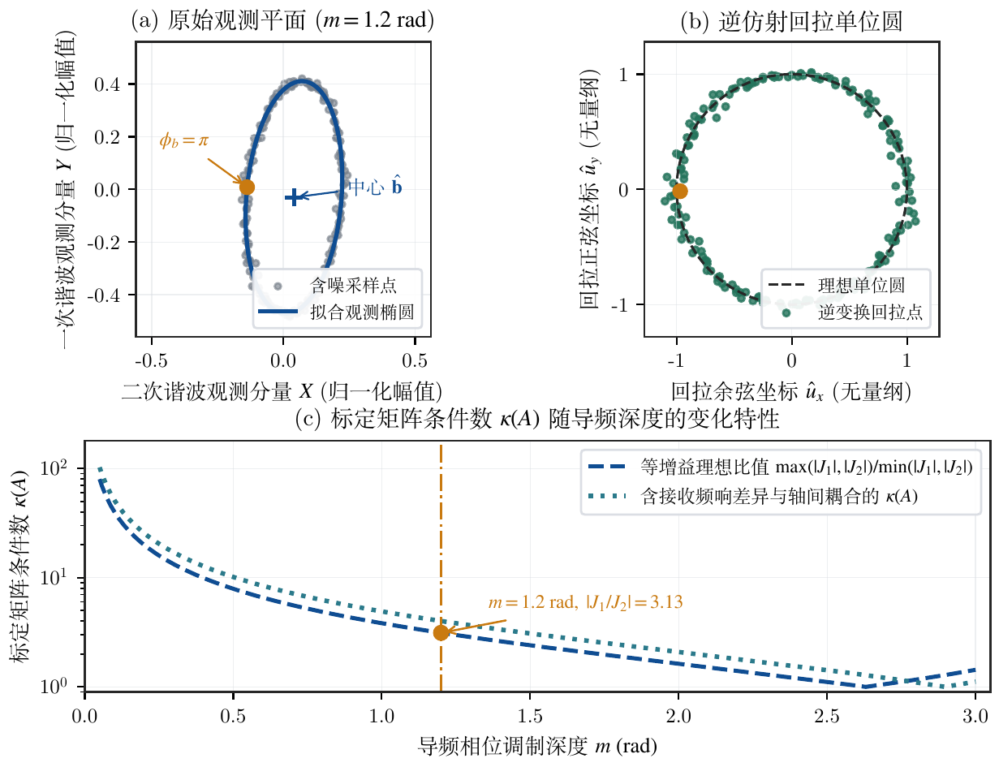
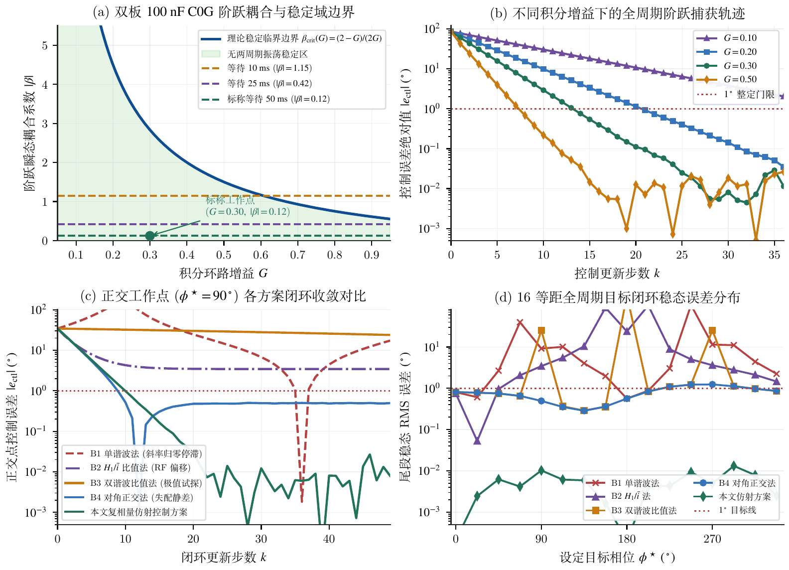

# 谐波解调与偏压控制

## 单 MZM 解调与校准

在[光-电一体化闭环](../architecture.md)中，[光学设计](optical.md)所述的调制器干涉光强经 `10%` 监测支路与 `H1 (PD IN)` 转换为电流，依次通过[电气设计](electrical.md)中的 `U12A` 跨阻放大（`CH0`）与 `R16` 直流检测（`CH1`）进入 `ADS131M02` `64 kSPS` 采样流；算法层输出的控制电压则经 `DAC8568 + OPA4192` 与导频叠加后由 `CN1 (VA/VB/VC)` 返回调制器电极。

1. **零泄漏相干解调**：在 `64 kSPS` 与 `f0 = 1 kHz` 下选取块长 `N = 1280`（`20 ms`，恰好容纳 `20` 个 `1 kHz` 周期、`40` 个 `2 kHz` 周期），彻底消除频谱泄漏。
2. **`O(1)` 内存主轴投影与 Fitzgibbon + 直流回归校准（`sizeof(ctrl_bias_scan_t) < 1024 B`）**：
   - **第一遍（主轴与半波电压估算）**：按 `256` 区间、`257` 步递增扫压（每步先 `0.2 s` 稳定、再 `0.2 s` 采样），`dsp_vpi_add()` 追踪 `Vpi`，同时用 12 个双精度 Welford 中心协方差累加量（`dsp_complex_cov_t`）求解复谐波 `Z1`、`Z2` 的主轴参考角 `(h1_ref_phase, h2_ref_phase)` 并记录 `CH1` 直流峰谷跨度 `dc_span = dc_max - dc_min`。
   - **极性契约**：当 `dc_span > 1 mV` 时直接以 `CH1` 直流极小值判别首个 `H1` 谷点是否为暗谷；当 `dc_span <= 1 mV`（无直流仿真）时保留 `ctrl_bias_scan_begin_fit(&scan, null_q_sign)` 通过 `H2` 有符号正交分量区分暗谷与亮峰。
   - **第二遍（`O(1)` 内存 Fitzgibbon 椭圆 + 同步 `CH1` 直流回归）**：将复相量投影至 `(h1_ref_phase, h2_ref_phase)` 得到有符号标量 `(s1, s2)`，令 `X = s2`、`Y = s1`。当 `dc_span > 1 mV` 时，在线累加中心归一化后的 `6×6` Fitzgibbon 散射矩阵下三角（`21` 个双精度数）、沿升压方向的鞋带环绕面积 `sum(X_prev*Y - X*Y_prev)` 以及 `CH1` 直流对 `[1, X, Y]` 的 `3×3` 最小二乘；通过 Schur 补与 `3×3` 对称 Jacobi 特征求解广义特征问题 `S a = lambda C a` 得到椭圆中心 `o` 与对称正定平方根 `M^{1/2}`，按中心化环绕方向选定反射阵 `F = diag(1, +/-1)`，并将直流回归系数经 `(F M^{1/2})^{-T}` 代数变换至单位圆 `(C_c, C_s)` 求得规范旋转角 `phi_c` 与暗谷零点 `null_v`。当 `dc_span <= 1 mV` 时平滑回退至 `dsp_online_lsq` 相位回归。

3. **纯圆周谐波观测器、冻结保护与无饱和 PI（[ctrl_observer.c](../../lib/control/ctrl_observer.c)）**：
   - 运行时先按 Bessel 比值 $J_1(m_{\mathrm{now}})/J_1(m_{\mathrm{cal}})$ 与 $J_2(m_{\mathrm{now}})/J_2(m_{\mathrm{cal}})$ 缩放 `M` 行向量再求逆；若 `cal.has_ref_phases` 为真则按 `(h1_ref_phase, h2_ref_phase)` 投影，否则默认使用 `(0, tau/4)`（兼容 `cos(h1_phase)` / `sin(h2_phase)` 零初始化测试）；
   - 已移除历史版本的 `spring` 电压惩罚、`obs_dc` 自减与 `bias_delta <= 0.30` 锁定门限，执行器仅在物理量程 `[min_v, max_v]` 限幅，允许热漂移跨周期连续跟踪而不误破锁；
   - 相位误差直接取精确圆周差 `error = remainder(target_rad - inst_rad, DSP_TAU)`，连续跟踪跨 `+/-pi` 相位 `phase_rad`，同时计算归一化圆残差指数滑动平均 `rho_ema = 0.9 * rho_ema + 0.1 * |r - 1.0|`；
   - **弱信号 / $J_0$ 过零冻结保护**：当 `r < 0.15` 时置位 `frozen = true`、`radius_ok = false` 并返回 `DSP_INCOMPLETE`；`ctrl_mod_mzm` 保持偏压与积分器状态不变并返回 `DSP_OK`，避免进入 `FAULT` 或在 $J_0(m_{\mathrm{RF}})$ 反号区误锁至 `180°` 反相工作点；
   - **闭环时序与自动重校准（[ctrl_thread.c](../../app/src/ctrl_thread.c)）**：`RUNNING` 在每次写偏压后丢弃 `wait_blocks`（默认 `3` 块 = `60 ms`，覆盖 `VA` 通道 `16.32 ms` 阶跃瞬态）并平均 `avg_blocks`（默认 `1` 块），控制周期 `dt = (wait_blocks + avg_blocks) * 20 ms`；支持无量纲增益 `G`（`kp = 0`，`ki = G * Vpi / (pi * dt)`）或直接 `kp/ki`；当 `recal_auto = 1` 且 `rho_ema > rho_thresh`（默认 `0.25`）持续 `hold_ticks`（默认 `15`）个有效更新时，自动执行重校准并恢复至原目标同时累加 `recal_count`。

## 谐波模型与可观测性

在[光学设计](optical.md)的余弦坐标中令导频为 $m\sin\omega t$。Jacobi–Anger 展开给出正弦基波系数 $-2J_1(m)\sin\phi_b$ 和余弦二次谐波系数 $2J_2(m)\cos\phi_b$，两者均省略公共光功率因子。电极反相注入使奇次项翻号，TIA 再将两项翻号。因此 ADC 基波保留原符号，二次项反号。注入延迟在第 $n$ 次谐波产生 $n\delta_i$ 的相移，接收链再叠加该频点的相移。

小导频下 $J_1(m)\simeq m/2$、$J_2(m)\simeq m^2/8$。理想观测矩阵的条件数 $\kappa(A)\simeq4/m$，弱轴由二次谐波决定。若 $\Sigma_n$ 为谐波噪声协方差，$\mathbf t$ 为单位圆切向量，则相位噪声方差为 $\mathbf t^T A^{-1}\Sigma_n A^{-\mathsf T}\mathbf t$。

每窗在第 20、40 个频点用 `goertzel_result_fast()` 求幅相。校准扫描阶段每 10 窗更新一次（`DSP_CONTROL_DECIMATION = 10`、5 Hz），两遍各扫 257 点；`RUNNING` 闭环阶段默认以 `wait_blocks = 3`、`avg_blocks = 1` 组成 `80 ms` 周期（`12.5 Hz`）。[在线最小二乘与 Fitzgibbon 模块](../../lib/dsp/dsp_online_lsq.c)和[扫压状态机](../../lib/control/ctrl_bias_engine.c)分别负责数值累加与步进。

观测器求 2×2 逆矩阵前按 `FLT_EPSILON` 检查行列式。归一化可消除公共正增益，但射频因子 $J_0(m_{RF})$ 过零时谐波幅度消失，跨过零点还会改变符号，由 `r < 0.15` 冻结门限拦截。[PI](../../lib/control/ctrl_pid.c) 将积分电压及输出限制在物理执行器允许范围 `[min_v, max_v]`，防止执行器饱和后继续累积积分。

## Phase 5 规划

无缝切点要求连续跟踪 `phi_now`，按当前条纹周期更新目标对应的电压范围 `[lo, hi]`，保持采样连续，避免偏压跨周期跳变。DPMZM 采用固定双导频，VA 为 962.5 Hz，VC 为 1762.5 Hz，VB 仅施加直流。64 kSPS 下每窗 `DSP_TDM_BLOCK_SIZE = 5120`，频率分辨率为 12.5 Hz。两子臂基波分别落在第 77、141 个频点，父臂差频及和频分别落在第 64、218 个频点。

## 仿真与误差基线

[宿主机光学仿真](../../tests/host/sim/test_mzm.c)用双线性变换实现单极点接收链（基波约 −82°），叠加幅度为 `0.006 * dither` 的残余幅度调制、谐波拾取、0.63 倍光功率阶跃、跨周期热漂移与光功率跌落冻结测试，并同时验证 `CH1` 同步直流 Fitzgibbon 标定路径与零直流回退路径。

论文第 5 章的 16 目标仿真使用统一光路、0.5% 半波电压漂移及通道失配。下表为各方法的全周期最差点条件误差预算，与实板锁定读数分别记录。

| 方法 | 最差点预算 |
| --- | ---: |
| B1 单谐波匹配 | 180.0° |
| B2 基波与平均电流比值 | 294.6° |
| B3 双谐波幅度比值 | 1.124° |
| B4 对角正交反正切 | 2.957° |
| 冻结仿射标定 | 0.184° |
| 仿射标定加在线追踪 | 0.044° |

