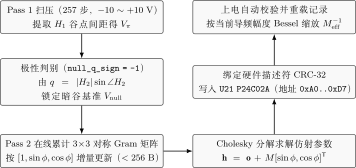
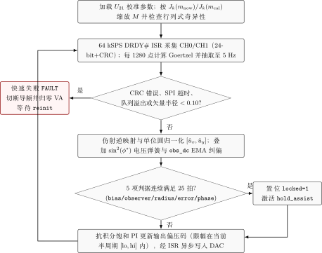
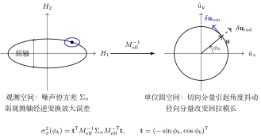
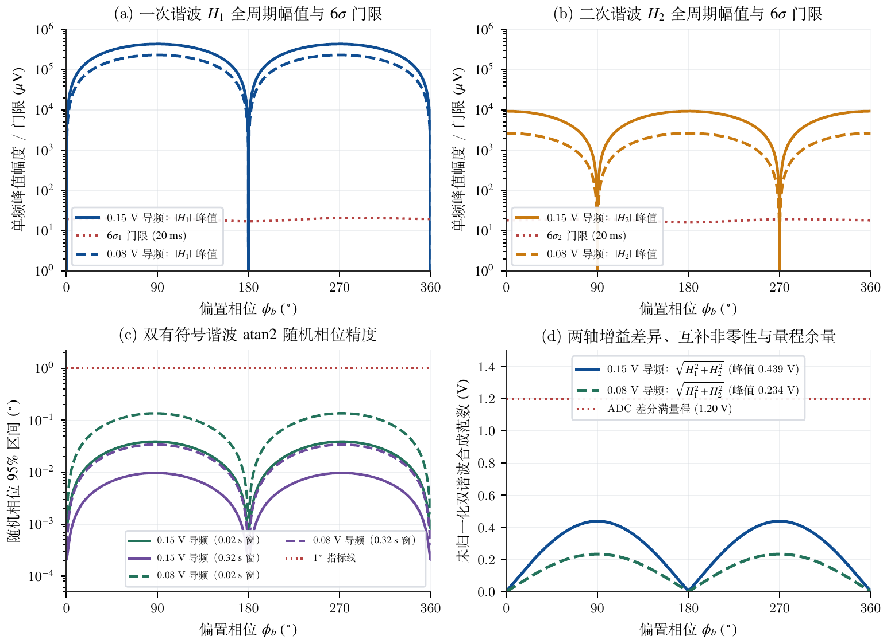
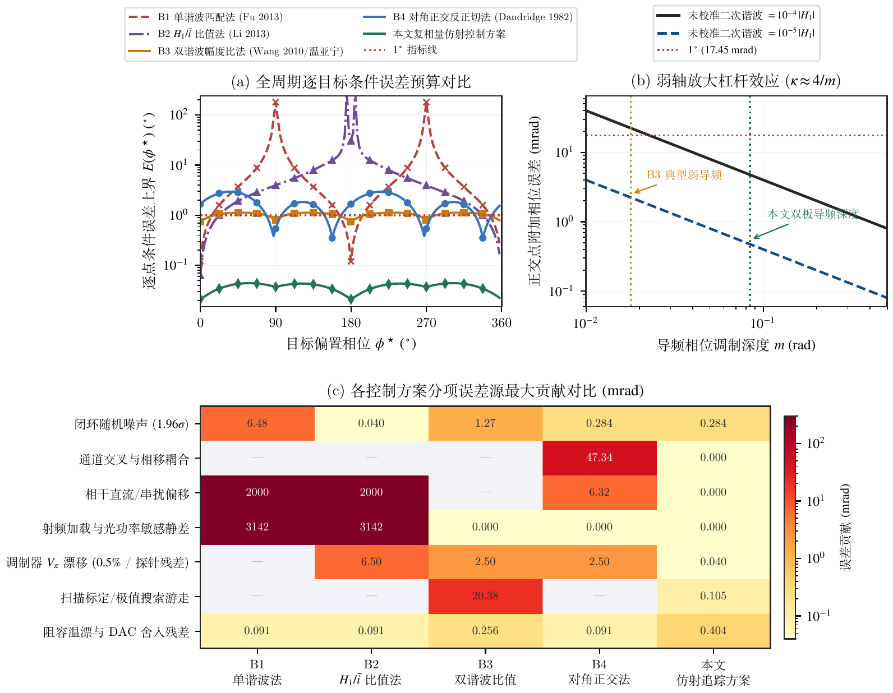

# 谐波解调与偏压控制

## 单 MZM 解调与校准

在[光-电一体化闭环](../architecture.md)中，[光学设计](optical.md)所述的调制器干涉光强经 `10%` 监测支路与 `H1 (PD IN)` 转换为电流，依次通过[电气设计](electrical.md)中的 `U12A` 跨阻放大（`CH0`）与 `R16` 直流检测（`CH1`）进入 `ADS131M02` `64 kSPS` 采样流；算法层输出的控制电压则经 `DAC8568 + OPA4192` 与导频叠加后由 `CN1 (VA/VB/VC)` 返回调制器电极。

1. **零泄漏相干解调**：在 `64 kSPS` 与 `f0 = 1 kHz` 下选取块长 `N = 1280`（`20 ms`，恰好容纳 `20` 个 `1 kHz` 周期、`40` 个 `2 kHz` 周期），彻底消除频谱泄漏。
2. **`O(1)` 内存两遍扫描校准（`< 1 KiB` 扫描状态）**：
   - 第一遍（`256` 区间、`257` 步，每步先 `0.2 s` 稳定、再 `0.2 s` 采样，约 `103 s`）：由 `dsp_vpi_add()` 选取低于已见峰值 10% 的 `H1` 谷点，对孤立谷点作三点抛物线顶点细化，估算半波电压 `Vpi` 并记录首个谷点有符号 `H2` 正交分量 `first_valley_q`。
   - **极性契约（`null_q_sign = -1`）**：实测 `20261110-MZM` 受 `U12A` 反相跨阻与 `2 kHz` 模拟/ADC 相移影响，暗谷（`MIN(0°)`）处的 `q = h2 * sin(h2_phase)` 为负（相位约 `-1.708 rad`），峰点（`MAX(180°)`）为正（相位约 `+1.433 rad`）；[ctrl_thread.c](../../app/src/ctrl_thread.c) 调用 `ctrl_bias_scan_begin_fit(&scan, -1)` 识别真正暗谷基准 `null_v`。
   - 第二遍（约 `103 s`）：通过 `dsp_online_lsq` 在线按 [1, sin φ, cos φ] 累加 3×3 对称 Gram 矩阵（`gram[6]`）及两路右端项（`rhs[3][2]`），经 Cholesky 分解求解偏置 `o[2]` 与 `2×2` 仿射耦合矩阵 `M[2][2]`，全程无需存储整条扫描波形数组。

3. **谐波相位观测器与防积分饱和 PI（[ctrl_observer.c](../../lib/control/ctrl_observer.c)）**：
   - 运行时先按 Bessel 比值 $J_1(m_{\mathrm{now}})/J_1(m_{\mathrm{cal}})$ 与 $J_2(m_{\mathrm{now}})/J_2(m_{\mathrm{cal}})$ 缩放 `M` 行向量再求逆；
   - 单位圆归一化 `[obs_x, obs_y]` 以消除光强与 RF 功率波动影响；
   - `CH1` 直流均值不混入主相位环，利用 $\sin^2(\phi_{\mathrm{target}})$ 电压弹簧项与快速 `obs_dc` EMA（`alpha = 0.50`）抑制偏置邻周期吸引域偏差；
   - 需同时满足 `bias_ok`、`observer_ok`、`radius_ok >= 0.10`、`error_ok`（`< 0.20/pi`）、`phase_ok`（目标半球）才置位 `locked=1`，连续 `25` 拍激活 `hold_assist_active`。

## 谐波模型与可观测性

在[光学设计](optical.md)的余弦坐标中令导频为 $m\sin\omega t$。Jacobi–Anger 展开给出正弦基波系数 $-2J_1(m)\sin\phi_b$ 和余弦二次谐波系数 $2J_2(m)\cos\phi_b$，两者均省略公共光功率因子。电极反相注入使奇次项翻号，TIA 再将两项翻号。因此 ADC 基波保留原符号，二次项反号。注入延迟在第 $n$ 次谐波产生 $n\delta_i$ 的相移，接收链再叠加该频点的相移。

小导频下 $J_1(m)\simeq m/2$、$J_2(m)\simeq m^2/8$。理想观测矩阵的条件数 $\kappa(A)\simeq4/m$，弱轴由二次谐波决定。若 $\Sigma_n$ 为谐波噪声协方差，$\mathbf t$ 为单位圆切向量，则相位噪声方差为 $\mathbf t^T A^{-1}\Sigma_n A^{-T}\mathbf t$。

每窗在第 20、40 个频点用 `goertzel_result_fast()` 求幅相。每 10 窗更新一次，即 `DSP_CONTROL_DECIMATION = 10`、5 Hz。两遍各扫 257 点，核心 LSQ 与谷点跟踪结构合计小于 256 B。[在线最小二乘](../../lib/dsp/dsp_online_lsq.c)和[扫压状态机](../../lib/control/ctrl_bias_engine.c)分别负责数值累加与步进。

观测器求 2×2 逆矩阵前按 `FLT_EPSILON` 检查行列式。归一化可消除公共正增益，但射频因子 $J_0(m_{RF})$ 过零时谐波幅度消失，跨过零点还会改变符号。`obs_dc` 的预热长度为 5 拍。[PI](../../lib/control/ctrl_pid.c) 将积分电压及输出限制在当前分支允许范围，防止执行器饱和后继续累积积分。

## Phase 5 规划

无缝切点要求连续跟踪 `phi_now`，按当前条纹周期更新目标对应的电压范围 `[lo, hi]`，保持采样连续，避免偏压跨周期跳变。DPMZM 采用固定双导频，VA 为 962.5 Hz，VC 为 1762.5 Hz，VB 仅施加直流。64 kSPS 下每窗 `DSP_TDM_BLOCK_SIZE = 5120`，频率分辨率为 12.5 Hz。两子臂基波分别落在第 77、141 个频点，父臂差频及和频分别落在第 64、218 个频点。

## 仿真与误差基线

[宿主机光学仿真](../../tests/host/sim/test_mzm.c)用双线性变换实现单极点接收链（基波约 −82°），叠加幅度为 `0.006 * dither` 的残余幅度调制、谐波拾取、0.63 倍光功率阶跃及漂移，检查各目标的闭环相位。

论文第 5 章的 16 目标仿真使用统一光路、0.5% 半波电压漂移及通道失配。下表为各方法的全周期最差点条件误差预算，与实板锁定读数分别记录。

| 方法 | 最差点预算 |
| --- | ---: |
| B1 单谐波匹配 | 180.0° |
| B2 基波与平均电流比值 | 294.6° |
| B3 双谐波幅度比值 | 1.124° |
| B4 对角正交反正切 | 2.957° |
| 冻结仿射标定 | 0.184° |
| 仿射标定加在线追踪 | 0.044° |

