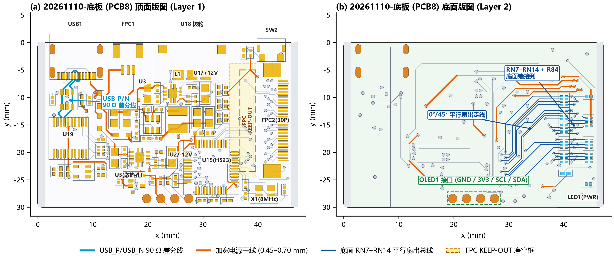
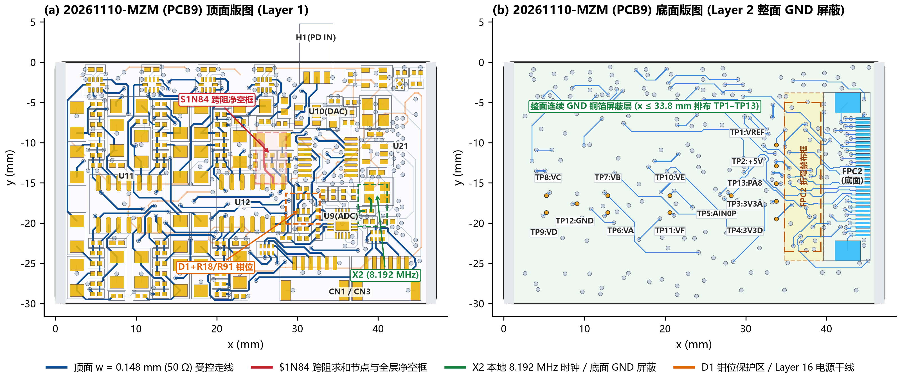
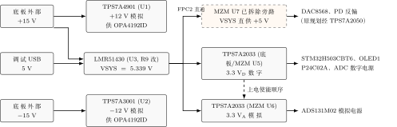
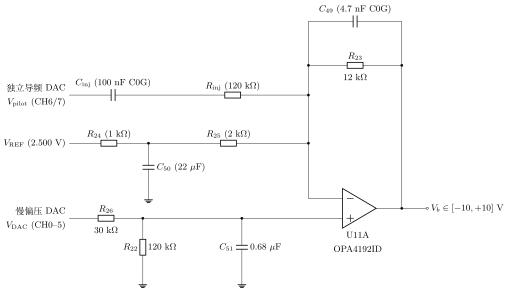
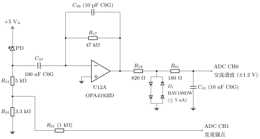
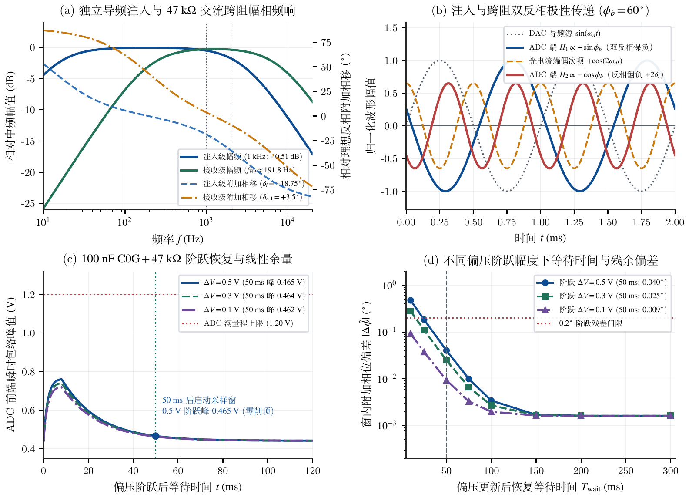
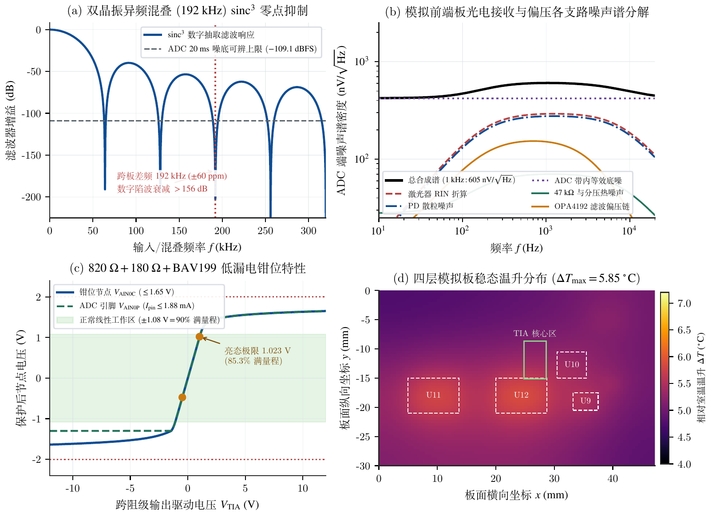
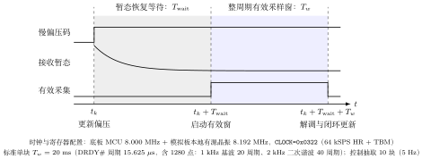

# 电气设计

## 板叠与排线

两板外形均为 47.20 × 30.00 × 1.60 mm，圆角 R1.0，板间净距 6.00 mm。底板顶面与子板底面的 KH-CL0.5-H2.0-30PIN 由 30 mm 长、0.5 mm 间距的 A 型同面触点 FFC 相连。结构尺寸、面板开孔及装机步骤见[机械与外壳设计](mechanical.md)。

底板为双层 FR-4。USB_P/N 的 90.0 Ω 差分 CPWG 线宽 0.300 mm，线距 0.154 mm，对地间距 0.200 mm，长度分别为 9.570、9.622 mm。子板采用 JLC04161H-3313 四层板，外铜 1 oz、内铜 0.5 oz，3313 半固化片厚 0.100 mm，介电常数 4.1。顶层线宽 0.148 mm、对地间距 0.200 mm 对应 50.0 Ω。TIA 求和节点 `$1N84` 线宽 0.127 mm，下方各层避让非地走线。Layer 15 为无走线的连续地平面，Layer 16 布电源干线及八路开关控制线，底层 Layer 2 铺地并放置 FPC2 与 TP1–TP13。

## FPC2 引脚表

引脚和坐标据《MZM 总板 20261110 交付文档》。表中开关位号标识原焊盘，实装飞线见 [PCB 勘误](pcb-errata.md)。

| 底板 `FPC2` | MZM `FPC2` | 信号功能 | 底板 `U15` (STM32H503CBT6) | 底板串联与上下拉元件（底层） | MZM 板网络与目标器件引脚 |
| :---: | :---: | --- | :---: | --- | --- |
| 1 | 30 | `GND` | — | — | `GND` |
| 2 | 29 | `PA0` | 10 (`PA0`) | `RN10` (5-4, `100 Ω`)；`RN12.5` (`4.7 kΩ` 下拉 `GND`) | `PA0` → `U14.1` (TS5A23159) |
| 3 | 28 | `PA1` | 11 (`PA1`) | `RN10` (6-3, `100 Ω`)；`RN12.6` (`4.7 kΩ` 下拉 `GND`) | `PA1` → `U16.1` (TS5A23159) |
| 4 | 27 | `PA2` | 12 (`PA2`) | `RN10` (7-2, `100 Ω`)；`RN12.7` (`4.7 kΩ` 下拉 `GND`) | `PA2` → `U16.5` (TS5A23159) |
| 5 | 26 | `PA3` | 13 (`PA3`) | `RN10` (8-1, `100 Ω`)；`RN12.8` (`4.7 kΩ` 下拉 `GND`) | `PA3` → `U14.5` (TS5A23159) |
| 6 | 25 | `GND` | — | — | `GND` |
| 7 | 24 | `PB6` | 42 (`PB6`) | `RN11` (5-4, `100 Ω`)；`RN13.5` (`4.7 kΩ` 下拉 `GND`) | `PB6` → `U17.5` (TS5A23159) |
| 8 | 23 | `PA15` | 38 (`PA15`) | `RN11` (6-3, `100 Ω`)；`RN13.6` (`4.7 kΩ` 下拉 `GND`) | `PA15` → `U20.5` (TS5A23159) |
| 9 | 22 | `PA6` | 16 (`PA6`) | `RN11` (7-2, `100 Ω`)；`RN13.7` (`4.7 kΩ` 下拉 `GND`) | `PA6` → `U20.1` (TS5A23159) |
| 10 | 21 | `PA4` | 14 (`PA4`) | `RN11` (8-1, `100 Ω`)；`RN13.8` (`4.7 kΩ` 下拉 `GND`) | `PA4` → `U17.1` (TS5A23159) |
| 11 | 20 | `CLK1` | 15 (`PA5`) | `RN7` (5-4, `33 Ω`) | `DAC_CLK` → `U10.16` (DAC8568 `SCLK`) |
| 12 | 19 | `DIN1` | 17 (`PA7`) | `RN7` (6-3, `33 Ω`) | `DAC_DIN` → `U10.15` (DAC8568 `DIN`) |
| 13 | 18 | `CLR1` | 18 (`PB0`) | `RN7` (7-2, `33 Ω`)；`RN14.5` (`10 kΩ` 上拉 `VDD33D`) | `DAC_CLR` → `U10.9` (DAC8568 `CLR`) |
| 14 | 17 | `SYNC1` | 19 (`PB1`) | `RN7` (8-1, `33 Ω`)；`RN14.6` (`10 kΩ` 上拉 `VDD33D`) | `DAC_SYNC` → `U10.2` (DAC8568 `SYNC`) |
| 15 | 16 | `LDAC1` | 20 (`PB2`) | `RN8` (5-4, `33 Ω`)；`RN14.7` (`10 kΩ` 上拉 `VDD33D`) | `DAC_LDAC` → `U10.1` (DAC8568 `LDAC`) |
| 16 | 15 | `SYNC2` | 33 (`PA12`) | `RN8` (6-3, `33 Ω`)；`RN14.8` (`10 kΩ` 上拉 `VDD33D`) | `ADC_SYNC` → `U9.9` (ADS131M02 `SYNC/RESET`) |
| 17 | 14 | `DRDY2` | 32 (`PA11`) | `RN8` (7-2, `33 Ω`) | `DRDY2` → `R94` (`33 Ω`) → `U9.11` (`DRDY`) |
| 18 | 13 | `PA8` | 29 (`PA8`) | `RN8` (8-1, `33 Ω`) | `PA8` → `TP13`（备用数字脚） |
| 19 | 12 | `GND` | — | — | `GND` |
| 20 | 11 | `MOSI2` | 28 (`PB15`) | `RN9` (5-4, `33 Ω`) | `ADC_MOSI` → `U9.14` (ADS131M02 `DIN`) |
| 21 | 10 | `MISO2` | 27 (`PB14`) | `RN9` (6-3, `33 Ω`) | `MISO2` → `R93` (`33 Ω`) → `U9.13` (`DOUT`) |
| 22 | 9 | `SCLK2` | 26 (`PB13`) | `RN9` (7-2, `33 Ω`) | `ADC_SCLK` → `U9.12` (ADS131M02 `SCLK`) |
| 23 | 8 | `ADCCS` | 25 (`PB12`) | `RN9` (8-1, `33 Ω`)；`R84` (`10 kΩ` 上拉 `VDD33D`) | `ADC_CS` → `U9.10` (ADS131M02 `CS`) |
| 24 | 7 | `I2C1_SDA` | 43 (`PB7`) | 共用底板 `R5` (`4.7 kΩ` 上拉 `VDD33D`) | `I2C1_SDA` → `U21.3` (P24C02A `SDA`) |
| 25 | 6 | `I2C1_SCL` | 45 (`PB8`) | 共用底板 `R4` (`4.7 kΩ` 上拉 `VDD33D`) | `I2C1_SCL` → `U21.1` (P24C02A `SCL`) |
| 26 | 5 | `GND` | — | — | `GND` |
| 27 | 4 | `+12V` | — | `U1` (TPS7A4901) 输出，双过孔并联，`TP1` | `+12V` → 双过孔并联 → `C82` (`10 µF`)、`U11.4`、`U12.4` |
| 28 | 3 | `-12V` | — | `U2` (TPS7A3001) 输出，双过孔并联，`TP2` | `-12V` → 双过孔并联 → `C83` (`10 µF`)、`U11.11`、`U12.11` |
| 29 | 2 | `GND` | — | — | `GND` |
| 30 | 1 | `VSYS` | — | `U3` (LMR51430) 输出，双过孔并联，`TP3` | `VSYS` → 双过孔并联 → `U5`、`U6` 本地 LDO 输入及旁路后的 `+5V` |

## 供电及热预算

外部 ±15 V 经底板 U1、U2 分别产生 ±12 V。U3（LMR51430XF，500 kHz FPWM）经 R9 返修输出 VSYS = 5.339 V。子板 U7 已旁路，VSYS 直供 +5V。底板 U5 生成 VDD33D，子板 U5、U6 分别生成 VDD33D、VDD33A，三者均为 TPS7A2033。下表为返修前 PCB 的 IPC-2152 设计估算，按环境 35 °C、铜温 75 °C 计算。

| 板卡与网络 / 器件 | 干线宽度 / 封装 | 常态电流 | 满载 / 限流极限 | 满载走线压降 $\Delta V$ | 满载走线温升 / 器件结温升 |
| --- | --- | :---: | :---: | :---: | :---: |
| 底板 `+15V`、`-15V` 输入干线 | `0.50–0.60 mm` (`1 oz`) | `84 mA` / `9 mA` | `270 mA` / `200 mA` | `≤ 4.8 mV` | 走线 $\Delta T < 0.5\ ^\circ\text{C}$ |
| 底板 `U3` Buck 开关与 `VSYS` 干线 | `0.60–0.70 mm` (`1 oz`) | `168 mA` | `300 mA`（峰值 `1.2 A`） | `≤ 8.5 mV` | 走线峰值 $\Delta T = 2.5\ ^\circ\text{C}$；`U3` $\Delta T_j \le 27.7\ ^\circ\text{C}$ |
| 底板 `VDD33D` 干线及 `U5` (`TPS7A2033`) | `0.45 mm` (`1 oz`) / `SOT-23-5` | `135 mA` | `180 mA` | `≤ 13.7 mV` | 走线 $\Delta T = 0.4\ ^\circ\text{C}$；`U5` 紧邻双散热地过孔，$\Delta T_j = 45.4\ ^\circ\text{C}$（满载 $60.5\ ^\circ\text{C}, T_j = 95.5\ ^\circ\text{C} < 125\ ^\circ\text{C}$） |
| 底板 `±12V` 干线及 `U1`/`U2` LDO | `0.45 mm` (`1 oz`) / `HVSSOP-8-EP` | `11 mA` / `9 mA` | `150 mA` / `200 mA` | `≤ 12.6 mV` | `U1`/`U2` 底部散热焊盘阵列过孔接地，$\Delta T_j \le 28.1\ ^\circ\text{C}$ |
| MZM 板 `Layer 16` `VSYS`、`±12V` 干线 | `0.50–0.55 mm` (`0.5 oz`) | `33 mA` / `11 mA` | `90 mA` / `200 mA` | `≤ 10.4 mV` | 内层走线满载 $\Delta T < 1.2\ ^\circ\text{C}$；`FPC2` 电源脚均配双并联过孔 |
| MZM 板 `Layer 16` `+5V`、`VDD33D/A` | `0.36–0.42 mm` (`0.5 oz`) | `15 mA` / `10 mA` | `45 mA` / `25 mA` | `≤ 3.5 mV` | `U5`/`U6`/`U7`（原型 `U7` 已旁路）本地 LDO 满载 $\Delta T_j \le 8.4\ ^\circ\text{C}$ |
| MZM 板 `U11`/`U12` (`OPA4192` 四运放) | `SOIC-14` | `4.2 mA`/颗 | 单臂误接 `50 Ω`（受 `U1` `150 mA` 限流约束） | — | 常态高阻负载 $P = 101\text{ mW}, \Delta T_j = 8.5\ ^\circ\text{C}$；外部 `50 Ω` 误接限流极限 $T_j \le 114\ ^\circ\text{C} < 150\ ^\circ\text{C}$ |

## 测试点（板图坐标，mm）

底板顶面：TP1 +12V (25.55, −17.23)，TP2 −12V (20.30, −23.23)，TP3 VSYS (14.30, −10.98)，TP4 VDD33D (8.80, −12.48)，TP5 GND (17.30, −27.23)。子板底面如下。

| 位号 | 网络 | 坐标 `(x, y) / mm` | 位号 | 网络 | 坐标 `(x, y) / mm` |
| :---: | --- | :---: | :---: | --- | :---: |
| `TP1` | `VREF` | `(33.80, -10.30)` | `TP8` | `VC` | `(5.30, -16.60)` |
| `TP2` | `+5V` | `(33.80, -12.90)` | `TP9` | `VD` | `(5.30, -18.70)` |
| `TP3` | `VDD33A` | `(33.80, -17.30)` | `TP10` | `VE` | `(20.60, -16.60)` |
| `TP4` | `VDD33D` | `(33.80, -19.50)` | `TP11` | `VF` | `(20.60, -18.70)` |
| `TP5` | `AIN0P` | `(28.20, -16.60)` | `TP12` | `GND` | `(9.10, -17.60)` |
| `TP6` | `VA` | `(12.90, -18.70)` | `TP13` | `PA8` | `(33.80, -15.10)` |
| `TP7` | `VB` | `(12.90, -16.60)` | — | — | — |

## 数字底板核心资源与引脚映射（`STM32H503CBT6` LQFP48）
- **主频与资源**：片外 `8 MHz` 无源晶振（`PH0/PH1`）经 `PLL1`（`div-m=2, mul-n=125, div-p=2`）倍频至 `SYSCLK = HCLK = APB1/2/3 = 250 MHz`；片内 SRAM `32 KiB`、Flash `128 KiB`。
- **FPC2 压摆率约束**：所有跨越 `30-pin FPC2` 排线的数字引脚在 [biasctrl_h503.dts](../../boards/xidian/biasctrl_h503/biasctrl_h503.dts) 中统一强制设定为 **`low-speed`**（禁止设为 `very-high-speed`），用于抑制排线感性振铃。

| 外设/功能 | 引脚分配 | 电气与工作参数 | 源码位置 |
| --- | --- | --- | --- |
| 控制台 `USART1` | `PA9 (TX)`, `PA10 (RX)` | `115200 bps 8N1`，中断驱动环形缓冲 | [biasctrl_h503.dts](../../boards/xidian/biasctrl_h503/biasctrl_h503.dts) |
| 共享 `I2C1` | `PB8 (SCL)`, `PB7 (SDA)` | `400 kHz` 快速模式，`OLED1 (0x3C)` 与 `U21 (0x50)` 经 `bias_i2c1_mutex` 互斥 | [shared_i2c.c](../../drivers/eeprom_board/shared_i2c.c) |
| DAC `SPI1` (`DAC8568`) | `PA5 (SCK)`, `PA7 (MOSI)`, `PB1 (SYNC#)`, `PB2 (LDAC#)`, `PB0 (CLR#)` | `12.5 MHz`，`CPHA=1`，`GPDMA1 CH0/CH1`，全 `low-speed` | [dac8568.c](../../drivers/dac8568/dac8568.c) |
| ADC `SPI2` (`ADS131M02`) | `PB13 (SCK)`, `PB14 (MISO)`, `PB15 (MOSI)`, `PB12 (CS#)`, `PA11 (DRDY#)`, `PA12 (SYNC#)` | `12.5 MHz`，`CPHA=1`，`GPDMA1 CH2/CH3 HIGH`，`64 kSPS` `DRDY#` 下降沿触发 | [ads131m02_dma.c](../../drivers/ads131m02/ads131m02_dma.c) |
| 导频开关 GPIO | `PA0, PA1, PA2, PA3, PA4, PA6, PA15, PB6` | 推挽 `low-speed`，开机与故障时全部拉低；`PA8` 固定为低速 GPIO（禁用 `MCO1`） | [pilot_mux_gpio.c](../../drivers/pilot_mux/pilot_mux_gpio.c) |
| 本地 UI (`KEY1–3` / `LED1`) | `PB3 / PB4 / PB5`（上拉低有效），`PC13`（高有效） | 拨轮开关 `20 ms` 软件去抖；`LED1` 正常 `500 ms` / 故障 `150 ms` | [keys.c](../../drivers/oled_lite/keys.c) |

## 模拟子板（`20261110-MZM`）信号链定量关系与实板基线

本子板通过后面板 `CN1 (VA/VB/VC)` 与前面板 `H1 (PD IN)` 构成光-电硬件接口边界：`CN1` 输出的直流偏压与导频幅度按调制器 $V_\pi$ 映射为光学相位 $\phi_b$ 与深度 $m$（见[光学设计](optical.md)）；`10%` 监测支路光功率（名义 `-9 dBm`、峰值 `≤ 344.4 µW / 310 µA`）经 `H1` 进入模拟前端，直接约束 `R15/R16`、`R17 = 47 kΩ` 与 `D1` 钳位裕量，且接收链反相与相移决定了[算法设计](algorithm.md)中的 `null_q_sign = -1` 极性契约。

1. **直流偏压链路（`DAC8568 CH0–CH5` -> `U11 OPA4192` 减法器）**：
   - `DAC8568` 使能内部 `2.500 V` 基准（输出 `0..5.000 V`，上电序列：`1 ms -> RESET(0x07000000) -> 2 ms -> REF_ENABLE(0x08000001) -> 5 ms (C46=10 uF) -> CH_ALL=32768`），通道写命令使用 `0x03 (CMD_WRITE_UPDATE)`。
   - 减法器传输关系（写入 `U21` 默认描述符）：
     $$V_{\mathrm{VA}} = 4 \left(V_{\mathrm{VOA}} - 2.500\ \mathrm{V}\right) \in [-10.000, +10.000]\ \mathrm{V}$$
     对应 `subtractor_gain_ppm = 8000000`、`subtractor_offset_uv = -10000000`，`0.000 V` 安全零点对应 DAC 码值 `32768`。
2. **交流导频链路（`DAC8568 CH6 DITHER1` / `CH7 DITHER2`）**：
   - 交流耦合后经反向比例缩放 $-R_{23}/R_{22} = -12\ \mathrm{k\Omega}/120\ \mathrm{k\Omega} = -0.10\ \mathrm{V/V}$ 叠加至 MZM 电极；DAC 满幅 `±2.500 V` 对应电极峰值 `RT_PIPELINE_PILOT_MAX_V = 0.25 V`，扫压与单 MZM 运行默认导频幅度 `SCAN_PILOT_V = 0.13 V`（对应 `U10.7` 输出 `±1.30 V` / 约 `0.919 Vrms`）。
3. **光电采样链路（`U12A` + `ADS131M02`）**：
   - `U12A` 采用反相跨阻放大（`tia_gain_ohms = 47000 Ω`）；`ADS131M02`（设备 ID 高字节 `0x22`，片外 `8.192 MHz` 晶振 `X2`，`24-bit` 四字帧含 CRC-16，增益 `1`，满量程 `±1.2 V` -> `RT_PIPELINE_ADC_V_PER_COUNT = 1.2 / 8388608 V/LSB`）。

直流全跨度 20 V 对应 305.2 µV/LSB，在半波电压 5.28 V 时约为 0.182 mrad/LSB。同相端等效电阻 30 kΩ ∥ 120 kΩ = 24 kΩ，与 C51/C55 等 0.68 µF 电容构成 16.32 ms、9.75 Hz 低通。基准支路的 1 kΩ、2 kΩ 和 22 µF 构成约 10.9 Hz 的 T 形滤波器。正交点 1 kHz 电极噪声估算为 56 nV/√Hz。

导频由 C48/C56（100 nF C0G）经 120 kΩ 注入，反馈网络为 12 kΩ ∥ 4.7 nF C0G。令 $s=j\omega$，传递函数为

$$T_i(s)=-0.1\frac{sR_{inj}C_{inj}}{1+sR_{inj}C_{inj}}\frac{1}{1+sR_f C_f}.$$

1 kHz 实际设计增益幅值为 0.09425，相对理想反相额外滞后 18.75°。固件导频幅值按名义增益 0.10 折算。

CH1 读取 R16（3.3 kΩ）上的直流电压，上支路为 R15（5 kΩ）。CH0 经 C37（100 nF C0G）隔直，时间常数 0.83 ms，对应 191.8 Hz。U12A 反馈为 R17（47 kΩ）∥ C39（10 pF C0G）。输出依次经过 R18（820 Ω）、D1 钳位节点（BAV199DW-7-F，漏电 ≤ 5 nA）、R91（180 Ω）及 C41（10 nF C0G）低通。折算至 ADC 输入端的噪声预算在 1、2 kHz 分别为 605.3、597.9 nV/√Hz。ADS131M02IRUKR 的 ID 高字节为 0x22，量化步长约 143 nV，帧校验为 CRC-16-CCITT。CLOCK 寄存器在 64 kSPS TBM 和 32 kSPS 模式分别为 0x0322、0x0302。

## 时钟与采样时序

底板 X1 为 8.000 MHz 无源晶体，PA8 禁用 MCO1。子板 X2 为 8.192 MHz、±30 ppm 有源 CMOS 晶振，经 R92（33 Ω）和 3.18 mm 走线驱动 ADC。差频 192 kHz 恰为数据率的三倍，落在 sinc³ 抽取滤波器的第三陷波点。双晶振合计 ±60 ppm 时，数字路径的设计抑制量为 155.7 dB。

启动时等待 X2 至少 6 ms（要求 5 ms），随后 SYNC# 拉低 300 µs（要求 250 µs）。每个 DRDY# 间隔为 15.625 µs，SPI1 和 SPI2 均为 12.5 MHz，32 位 DAC 帧占线 2.56 µs。采样期间由 DRDY# ISR 独占两条总线，轮询 DMA 完成的上限为 8 µs。调度与故障处理见[系统架构](../architecture.md)。

