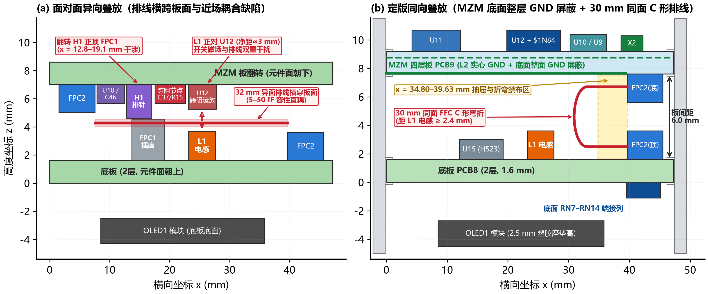
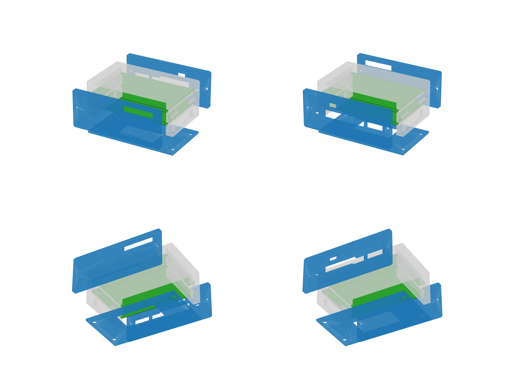

# 外壳与机械装配设计

本文档记录 `20261110-底板` 与 `20261110-MZM` 上下拆分双板的叠装结构、3D 打印导槽外壳尺寸、面板开孔坐标、外部线束/辅料清单及装配规程。配套 STEP/STL 三维模型文件位于硬件工程仓库 `physicalpcb/results/split_20261110/enclosure/`。

## 1. 上下叠装与外壳总体几何

两块电路板外形均为 `47.20 × 30.00 × 1.60 mm`（圆角 `R1.0 mm`），元件面同向朝上叠装，板间净距 `6.00 mm`，通过 `30 mm` 长同面触点 30 芯 `0.5 mm` 间距 FFC 排线呈 C 形连接并沿双层导槽滑入外壳。

| 结构参数项 | 设计数值 | 说明 |
| --- | --- | --- |
| 装配总外廓 `(X × Y × Z)` | `53.60 × 34.30 × 22.20 mm` | 壳体长 `30.30 mm`，前后盖板各厚 `2.00 mm`，显示面板厚 `1.20 mm` |
| 内腔净宽 / 净高 | `45.10 mm` / `19.00 mm` | 以底板底面为 `z = 0.0 mm`：底板下底 `z_inner_floor = -5.80 mm`，顶板内壁 `z_inner_ceiling = 13.20 mm` |
| 上下板高度坐标 | 底板 `z = 0.0..1.6 mm`；子板 `z = 7.6..9.2 mm` | 板间净距 `6.00 mm`，两只 `FPC2` 相对净距 `1.98 mm` |
| 导槽截面尺寸 | 槽高 `1.90 mm`，槽深 `1.25 mm` | 侧壁压住板边 `1.05 mm`，板边到槽底单侧余量 `0.20 mm` |
| 壳体壁厚与下底 | 侧壁 `2.00 mm`；外底 `z = -7.00 mm` | 底板下方净高 `5.80 mm`，子板上方净高 `4.00 mm` |
| 零件体积（CAD 导出） | 壳体 `7.72 cm³` / 前面板 `1.95 cm³` / 后面板 `2.17 cm³` | — |

## 2. 面板开孔与 `FPC KEEP-OUT` 禁布区

### 2.1 前面板、后面板与显示面板开孔尺寸

前面板与后面板各用两颗螺钉固定在左右侧壁（端面底孔 `Ø1.7 mm`、深 `8.0 mm`，面板通孔 `Ø2.3 mm`，坐标 `x = -1.175 mm` 与 `48.375 mm`、`z = 4.60 mm`）；显示面板沿屏幕法线独立拆装，四角采用 `Ø2.3 mm` 沉孔固定至左右壳壁。

| 面板 | 开孔 / 特征 | 坐标范围 / 尺寸（单位 `mm`） | 装配说明 |
| --- | --- | --- | --- |
| 前面板 | `USB1`（Type-C 口） | `x: 2.315..11.655`, `z: 1.490..5.051`；外部减薄沉槽 `USB_POCKET` `x: 0.785..19.783`, `z: -0.029..6.571` | 外表面减薄至厚 `1.30 mm`，适配 Type-C 插头注塑护套 |
| 前面板 | `FPC1`（`±15 V` 供电口） | `x: 13.483..19.283`, `z: 1.200..4.960` | 与 `U18` 拨轮窗口之间保留 `0.85 mm` 面板筋条 |
| 前面板 | `U18`（`WS-001CB` 拨轮） | `x: 18.567..37.567`, `z: 1.200..6.300`（净宽 `19.00`, 净高 `5.10`） | 轮盘厚 `4.00 ± 0.10 mm`，左右各转动 `24°`，入口倒角 `0.35 mm` |
| 前面板 | `H1`（`PD IN` 排母） | `x: 29.780..34.990`, `z: 7.850..10.950`（净宽 `5.21`, 净高 `3.10`） | 外部监测支路 `PIN PD` 光电流接入模拟子板接口（见[光学设计](optical.md)）；侧躺焊接，按引脚中心高出子板顶面 `0.20 mm` 建模（装配前按 [PCB 勘误](pcb-errata.md) `ERR-05` 核对） |
| 前面板 | `SW2`（复位按键） | `x: 41.168..43.668`, `z: 1.750..3.250` | — |
| 后面板 | `CN1 / CN3` 共用窗口 | `x: 27.651..45.501`, `z: 8.900..12.640` | `CN1 (VA/VB/VC)` 偏置与导频电极驱动输出口（见[电气设计](electrical.md)）；入口倒角 `0.80 mm` |
| 显示面板 | `OLED1` 视窗与 `LED1` 孔 | 视窗中心 `(23.622, -18.146)`，净尺寸 `23.144 × 12.264`，外倒角 `0.60 mm`；状态灯孔 `Ø2.0 mm` | 四角螺钉孔坐标 `(-0.75, -25.20)`、`(-0.75, -4.90)`、`(47.95, -25.20)`、`(47.95, -4.90)` |

### 2.2 `OLED1` 纵向堆叠与 `FPC KEEP-OUT` 禁布区

1. **`OLED1` 堆叠高度**：按 `MC096GX`（`27.30 × 27.80 mm`）四针模组核算，底板底面至屏幕玻璃外表面名义高度为：排针塑胶垫座 `2.50 mm` + 模组 PCB `1.20 mm` + 屏幕玻璃 `1.50 mm` = `5.20 mm`，距显示面板内表面保持 `0.60 mm` 装配间隙；模块背面排针尾端与焊点须修剪在模组 PCB 表面 `1.50 mm` 以内，并与 `USB1` 金属外壳焊脚（`x = 11.31 mm, y = -1.27 / -5.45 mm`）隔离绝缘（详见 [PCB 勘误](pcb-errata.md) `ERR-05`）。
2. **`FPC2` 排线与禁布区**：`KH-CL0.5-H2.0-30PIN` 锁扣向 `-x` 拉出约 `1.5 mm` 解锁，排线端头含 `4.0 mm` 蓝色硬质补强板。底板顶层抽屉行程区（`x = 36.60..39.63 mm, y = -24.70..-3.80 mm`）、排线折弯区（`x = 34.80..39.63 mm, y = -17.70..-6.90 mm`）及 MZM 板底层全区（`x = 34.80..39.63 mm, y = -24.70..-3.80 mm`）在丝印层标注为 `FPC KEEP-OUT`，排线 C 形弯折收拢后距底板电感 `L1` 东沿至少 `2.4 mm`。

## 3. 外部机械与线束辅料清单

以下辅料不在两块 PCB 的 SMT 贴片 BOM 内，需在装机前备齐：

| 序号 | 名称 | 规格要求 | 单套数量 | 用途说明 |
| :---: | --- | --- | :---: | --- |
| 1 | 30P FFC 软排线 | `0.5 mm` 间距，`30` 芯，**A 型同面触点（同向）**，全长 `30 mm`，宽 `15.5 mm`，两端蓝色补强板长 `4.0 mm` | 1 根 | 连接底板顶面 `FPC2` 与子板底面 `FPC2` |
| 2 | 前后盖螺钉 | `M2 × 6 mm` 盘头十字自攻螺钉（螺帽外径 `≤ 3.8 mm`） | 4 颗 | 前面板与后面板各两颗 |
| 3 | OLED 排针垫高座 | `2.54 mm` 间距 4P 单排针（含 `2.5 mm` 高黑色塑胶定位座） | 1 条 | 后焊底板底面 `0.96` 寸 OLED，垫高避开 `USB1` 插脚 |
| 4 | 显示面板螺钉 | `M2 × 5 mm`、90° 沉头自攻螺钉（头径 `≤ 4.0 mm`） | 4 颗 | 从显示面板外侧锁紧至左右壳壁 |

## 4. 3D 打印工艺与装机规程

### 4.1 3D 打印参数建议

- **摆放方向**：壳体筒体以端面贴紧打印平台（使导槽竖直）；前后面板均以内表面贴平台、接口倒角朝上；显示面板以内表面贴平台、视窗倒角与螺钉沉孔朝上。
- **打印参数**：材料选用 PETG、ABS 或高韧性 PLA+；`0.4 mm` 喷嘴，层高 `0.16 mm` 或 `0.20 mm`，外轮廓壁数 `≥ 3` 圈，填充率 `≥ 30%`，启用外轮廓尺寸补偿以保证 `1.90 mm` 导槽顺滑插入 `1.60 mm` PCB。

### 4.2 双板装配与拆卸步骤

1. **底板 OLED 后焊检查**：按底板底面 `GND-3V3-SCL-SDA` 丝印焊好带 `2.5 mm` 定位座的 `OLED1` 模块，修剪排针尾端至 `≤ 1.50 mm` 并在 `USB1` 外壳脚顶端贴覆聚酰亚胺胶带防短路。
2. **断电锁紧 FFC 排线**：完全断电状态下向板内拉出两板 `FPC2` 黑色抽屉锁扣，核对 `1 GND / 30 VSYS` 丝印方向，将 `30 mm` A 型同面触点排线分别对准底板顶面与子板底面触点插到底后推回锁扣。
3. **双板推入导槽**：底板在下、子板在上、元件面均朝上，将 FFC 排线自然收拢在 `FPC KEEP-OUT` 区域内，两板前沿对齐后沿导槽滑入壳体（USB 口朝向前面板）。
4. **锁紧前后面板**：前面板依次套过 `U18` 拨轮与 `H1` 排母，后面板对准 `CN1/CN3` 窗口，各拧入两颗 `M2 × 6 mm` 螺钉。拆卸时拔除线束并拆下端面板即可从任意一端推出双板。
5. **安装显示面板**：将状态灯孔对准底板 `LED1`，用四颗 `M2 × 5 mm` 沉头螺钉固定；单独拆下这四颗螺钉即可检修 `OLED1`。
