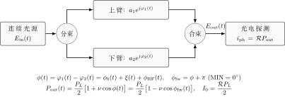
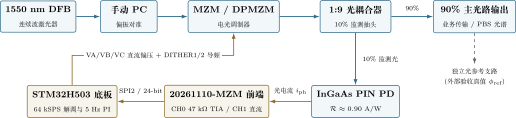

# 光路、光功率与锁定点

光路域作为本系统[光-电一体化闭环](../architecture.md)的被控对象，通过后面板 `CN1 (VA/VB/VC)` 接收偏压与导频激励，并通过 `1:9` 分束的监测支路经由 `InGaAs PIN PD` 与前面板 `H1 (PD IN)` 将光强谐波与直流电平送回 `20261110-MZM` 模拟子板（`U12A` / `R16`）。

## 单 MZM 的相位坐标与双坐标映射

设两臂场透射系数为 $a_1,a_2$，余弦干涉相位差为 $\phi_{\mathrm{thesis}}=\varphi_1-\varphi_2$。输出光强为

$$E_{out}=E_{in}(a_1e^{j\varphi_1}+a_2e^{j\varphi_2}),\qquad
P_{out}=\tfrac{P_L}{2}(1+\nu\cos\phi_{\mathrm{thesis}}).$$

其中 $P_L=2P_{in}(a_1^2+a_2^2)$，条纹可见度 $\nu=2a_1a_2/(a_1^2+a_2^2)\in[0,1]$，线性消光比 $P_{max}/P_{min}=(1+\nu)/(1-\nu)$。论文余弦坐标以亮峰 `MATP` 为零点（`MATP=0°`、`QTP+=+90°`、`MITP=180°`、`QTP-=270°/-90°`）；固件则以暗谷为零点，$\phi_{\mathrm{fw}}=\mathrm{wrap}(\phi_{\mathrm{thesis}}+\pi)$，功率正比于 $1-\nu\cos\phi_{\mathrm{fw}}$。两套坐标严格一一对应：

| 固件目标 | 固件相位 $\phi_{\mathrm{fw}}$ | 论文相位 $\phi_{\mathrm{thesis}}$ | 光学判据与直流斜率 |
| --- | ---: | ---: | --- |
| `MIN` | `0°` | `180°` (`MITP`) | 暗谷，`CH1` 直流极小，`H1` 趋零，实测 `H2` 相位 `−1.708 rad` |
| `QUAD` | `+90°` | `270° / −90°` (`QTP-`) | 半功率点，沿固件相位增加方向 `CH1` 直流斜率为正（上升沿） |
| `MAX` | `180°` | `0°` (`MATP`) | 亮峰，`CH1` 直流极大，`H1` 趋零，实测 `H2` 相位 `+1.433 rad` |
| `CUSTOM -90` | `−90°` | `+90°` (`QTP+`) | 半功率点，沿固件相位增加方向 `CH1` 直流斜率为负（下降沿） |
| `CUSTOM <deg>` | `<deg>` | `wrap(<deg> + 180°)` | 任意指定分支锁定，如 `135°` 位于 `QUAD` 与 `MAX` 之间 |

校准过程中，`CH1` 直流分量同步满足四参数模型 $V_{\mathrm{CH1}}(V)=A+B\cos\!\bigl(\frac{\pi}{V_\pi}(V-V_{\mathrm{lock}})+\phi_{\mathrm{true,thesis}}\bigr)$（$B>0$）。固件通过 `CH1` 直流 `[1, X, Y]` 回归把光强极小点映射为暗谷基准 `null_v`，并在 `dc_span <= 1 mV` 时保留 `null_q_sign = -1` 判据（解调与极性契约见[算法设计](algorithm.md)）。实板 `1550 nm` 监测直流范围为 `-0.992 .. 787.601 mV`，标定值与各点读数见[闭环实测](../experiments/bringup/phase4-closed-loop-verify.md)。

相位分解为 $\phi(t)=\phi_b(t)+\xi(t)+\phi_{RF}(t)$，其中 $\phi_b=\pi V_b/V_{\pi,DC}+\phi_0(t)$。直流微调满足 $\delta\phi=\pi\delta V_b/V_{\pi,DC}$。界面电荷和热光效应使 $\phi_0$ 漂移，半波电压的慢变还会改变电压到相位的斜率。计算导频调制深度时使用 $V_\pi(f_d)$，行波 RF 电极则使用 $V_{\pi,RF}(f_{RF})$。当射频调制深度逼近首个贝塞尔零点 $J_0(m_{\mathrm{RF}})=0$ 或光强深度衰落导致回拉半径 $r < 0.15$ 时，固件进入冻结保护并保持当前偏压，防止跨越零点反号后在 `180°` 反相分支误锁。

## 三臂 DPMZM（Phase 5 规划）

推挽子臂的有限消光比场模型为 $h(\phi)=\cos(\phi/2)+\delta e^{j\phi/2}$，其中 $\delta$ 表示幅度失配。嵌套输出场为

$$E_{DPMZM}=\tfrac12 E_{in}\left[(1+\delta_P)h_I+h_Qe^{j\phi_P}\right].$$

单只 PD 经 `H1 (PD IN)` 检测总强度。经 `CN1` 输出的 VA 子臂 I 固定接 DITHER1，从 $f_1,2f_1$ 提取误差；VC 子臂 Q 固定接 DITHER2，从 $f_2,2f_2$ 提取误差；VB 控制父臂直流相位，误差来自 $f_1\pm f_2$ 的交叉项（解调频点详见[算法设计](algorithm.md)）。单臂驱动还产生公共相位因子 $e^{j\chi}$，此时干涉项的相位为 $\phi_P+\chi_Q-\chi_I$。

## 监测光功率预算与台架

手动 PC 调整入射偏振，PBS 供光谱观测。闭环反馈来自固定监测支路的单只 PD。按响应度 0.90 A/W、暗电流 0.55 nA、结电容 5 pF 估算，监测支路平均 −9 dBm（125.89 µW）对应 $I_q=I_0=113.30$ µA。峰值至多 226.60 µA，在 R16 上产生 0.748 V，计入 ADC 输入负载后为 0.737 V。高功率预算以峰值 310 µA（344.4 µW）为限，对应 CH1 为 1.023 V，占 ±1.2 V 满量程的 85.2%，低于 90% 设计上限。前端元件与 ADC 量程见[电气设计](electrical.md)。
