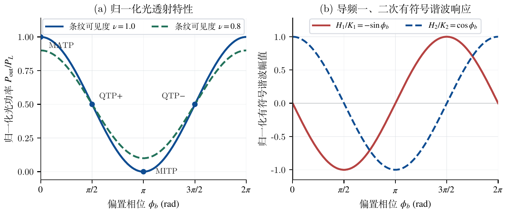

# 光路、光功率与锁定点

光路域作为本系统[光-电一体化闭环](../architecture.md)的被控对象，通过后面板 `CN1 (VA/VB/VC)` 接收偏压与导频激励，并通过 `1:9` 分束的监测支路经由 `InGaAs PIN PD` 与前面板 `H1 (PD IN)` 将光强谐波与直流电平送回 `20261110-MZM` 模拟子板（`U12A` / `R16`）。

## 单 MZM 的相位坐标

设两臂场透射系数为 $a_1,a_2$，相位差为 $\phi=\varphi_1-\varphi_2$。输出场为

$$E_{out}=E_{in}(a_1e^{j\varphi_1}+a_2e^{j\varphi_2}),\qquad
P_{out}=\tfrac{P_L}{2}(1+\nu\cos\phi).$$

其中 $P_L=2P_{in}(a_1^2+a_2^2)$，条纹可见度 $\nu=2a_1a_2/(a_1^2+a_2^2)\in[0,1]$，线性消光比 $P_{max}/P_{min}=(1+\nu)/(1-\nu)$。在该坐标中 MATP、QTP+、MITP 分别位于 0°、90°、180°。固件以暗谷为零点，$\phi_{fw}=\phi+\pi\pmod{2\pi}$，功率正比于 $1-\nu\cos\phi_{fw}$。

| 固件目标 | 固件相位 | 光学判据 |
| --- | --- | --- |
| MIN | 0° | 暗谷，H1 趋零，实测 H2 相位 −1.708 rad |
| QUAD | 90° | 半功率，沿固件相位增加方向光功率上升 |
| MAX | 180° | 亮峰，H1 趋零，实测 H2 相位 +1.433 rad |
| CUSTOM | 指定角度 | 在指定分支锁定，例如 135° 在 QUAD 与 MAX 之间 |

实板用 $q=|H_2|\sin(\angle H_2)$ 区分亮峰与暗谷，受 `U12A` 反相跨阻与接收链 `2 kHz` 相移影响，20261110-MZM 的暗谷判据为 `null_q_sign = -1`（解调与极性契约见[算法设计](algorithm.md)）。标定值与各点直流读数见[闭环实测](../experiments/bringup/phase4-closed-loop-verify.md)。

相位分解为 $\phi(t)=\phi_b(t)+\xi(t)+\phi_{RF}(t)$，其中 $\phi_b=\pi V_b/V_{\pi,DC}+\phi_0(t)$。直流微调满足 $\delta\phi=\pi\delta V_b/V_{\pi,DC}$。界面电荷和热光效应使 $\phi_0$ 漂移，半波电压的慢变还会改变电压到相位的斜率。计算导频调制深度时使用 $V_\pi(f_d)$，行波 RF 电极则使用 $V_{\pi,RF}(f_{RF})$。

## 三臂 DPMZM（Phase 5 规划）

推挽子臂的有限消光比场模型为 $h(\phi)=\cos(\phi/2)+\delta e^{j\phi/2}$，其中 $\delta$ 表示幅度失配。嵌套输出场为

$$E_{DPMZM}=\tfrac12 E_{in}\left[(1+\delta_P)h_I+h_Qe^{j\phi_P}\right].$$

单只 PD 经 `H1 (PD IN)` 检测总强度。经 `CN1` 输出的 VA 子臂 I 固定接 DITHER1，从 $f_1,2f_1$ 提取误差；VC 子臂 Q 固定接 DITHER2，从 $f_2,2f_2$ 提取误差；VB 控制父臂直流相位，误差来自 $f_1\pm f_2$ 的交叉项（解调频点详见[算法设计](algorithm.md)）。单臂驱动还产生公共相位因子 $e^{j\chi}$，此时干涉项的相位为 $\phi_P+\chi_Q-\chi_I$。

## 监测光功率预算与台架

手动 PC 调整入射偏振，PBS 供光谱观测。闭环反馈来自固定监测支路的单只 PD。按响应度 0.90 A/W、暗电流 0.55 nA、结电容 5 pF 估算，监测支路平均 −9 dBm（125.89 µW）对应 $I_q=I_0=113.30$ µA。峰值至多 226.60 µA，在 R16 上产生 0.748 V，计入 ADC 输入负载后为 0.737 V。高功率预算以峰值 310 µA（344.4 µW）为限，对应 CH1 为 1.023 V，占 ±1.2 V 满量程的 85.2%，低于 90% 设计上限。前端元件与 ADC 量程见[电气设计](electrical.md)。
