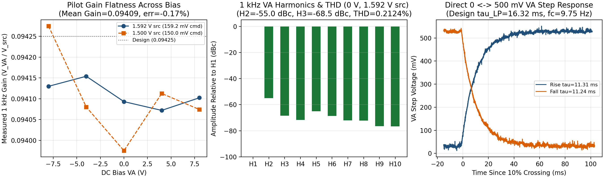

# EXP-007：C1 硬件基准体检与 C2 电光阶跃恢复及重复性验证

- **实验日期**：2026-11-26（`DM858E` 直流线性度与 `SDS824X HD` 偏压输出端示波器特性补测均于 2026-11-28 完成）
- **关联任务**：`openspec/changes/07-affine-thesis-experiments/`（`t4_exp_c1_c2`）
- **硬件与固件版本**：`20261110-底板`（`STM32H503CBT6` @ `250 MHz`）+ `20261110-MZM` 模拟子板（`U7` 旁路、`TS5A23159` 拆除飞线直连 `DITHER1 -> VA` / `DITHER2 -> VC`、`ADS131M02 CLOCK=0x0322` @ `64 kSPS`），固件 `P7 rev=b4bd711-dirty`
- **光路条件**：C1/C2 主试验采用固定功率 `1550 nm` 激光器 -> 偏振控制器（PC）-> MZM -> `1:9` 分光器 -> `10%` 监测光接入 `H1 (PD IN)`，`90%` 主路无外接探测器；C1 外部直流线性度与示波器补测期间保持断开 MZM 负载，分别将 `RIGOL DM858E` 与 `Siglent SDS824X HD`（`C1` `10×` 探头）直连 `CN1 VA` 输出端
- **外部仪器状态**：`RIGOL DG922 Pro` 全程保持射频输出关闭（`:OUTP1? = 0`）；外部补测使用 `RIGOL DM858E` 五位半数字万用表（`192.168.99.147:5025`，`DM8E275002095`）与 `Siglent SDS824X HD` 数字示波器（`192.168.99.157:5025`，`SDS08A0XA05949`，FW `4.8.12.1.1.6.5`，`12-bit`，`C1` `10×` 探头 + `20 MHz` 带宽限制）
- **原始日志与归档数据**：`.agent-bridge/exp_runs/c1_c2_live/`、`.agent-bridge/exp_runs/c1_dc_linearity_live/`、`.agent-bridge/exp_runs/c1_va_scope_live/`；归档汇总与图件见 [c1_c2_summary.json](../data/c1_c2/c1_c2_summary.json)、[c2_step_peaks.csv](../data/c1_c2/c2_step_peaks.csv)、[c2_twait_scan.csv](../data/c1_c2/c2_twait_scan.csv)、[c1_c2_fft_and_twait.png](../data/c1_c2/c1_c2_fft_and_twait.png)、[c1_dc_linearity_summary.json](../data/c1_c2/c1_dc_linearity_summary.json)、[c1_dc_full_sweep.csv](../data/c1_c2/c1_dc_full_sweep.csv)、[c1_dc_single_code_dnl.csv](../data/c1_c2/c1_dc_single_code_dnl.csv)、[c1_dc_linearity.png](../data/c1_c2/c1_dc_linearity.png)、[c1_va_scope_summary.json](../data/c1_c2/c1_va_scope_summary.json)、[c1_va_pilot_sweep.csv](../data/c1_c2/c1_va_pilot_sweep.csv)、[c1_va_scope_char.png](../data/c1_c2/c1_va_scope_char.png)

## 1. C1 板载硬件基准体检

### 1.1 上电复现性、时钟与 EEPROM 热重载（3 次冷启动）

通过 DAPLink SWD（`.venv/bin/pyocd reset`）连续执行 3 次冷启动并读取 `hw info` 与启动日志，全部初始化返回 `0`，`U21` 板载 `MZM2` 校准记录实现零差错重载：

| 指标 | 实测结果（3 次冷启动全一致） | 判定 |
| --- | --- | --- |
| 系统主频 `SYSCLK` | `250000000 Hz` | 通过 |
| `ADS131M02` 寄存器 | `ID=0x2205`, `STAT=0x0103`, `MODE=0x1111`, `CLOCK=0x0322` | 通过 |
| `U21` EEPROM 校验 | `desc_crc=0xF4B5CF6B`, `cal_status=0`, `cal_crc=0x978398EC` | 通过 |
| `ctrl_thread init` | `0`（3/3 次自动加载 `MZM2` 参数） | 通过 |

### 1.2 `64 kSPS` 真实采样率与中断确定性（`adc stat 100000`）

采集 `N = 100000` 个连续 `DRDY#` 周期（DWT `CYCCNT` 计时）：

| 参数 | 实测值 | 说明 |
| --- | --- | --- |
| 统计周期总计 `total_cyc` | `390624587` | 对应 `@ 250 MHz` 约 `1.5625 s` |
| 实测采样率 `fs_hz` | `64000.068 Hz` | 相对标称 `64000 Hz` 偏差 `+1.06 ppm` |
| 单周期极值 `[dt_min, dt_max]` | `[2607, 5216]` cycles | 偶发 UART/SysTick 中断抖动下无采样丢失 |
| `drops` / `crc` | `0` / `0` | 全程零丢块、零 SPI CRC 错误 |

### 1.3 `CH0` 空闲态噪声谱与 `192 kHz` 混叠位置（`adc dump 8192`）

在 `IDLE` 态（`VA = 0 V`、导频关闭、CW 光路直通，`100 nF` 隔直电容隔离直流、`U12A` 仅放大交流电流噪声）采集 `8192` 点原始 `CH0` 样本，取 `6` 个完整 `1280` 点（`20 ms`，频率分辨率 `50 Hz`）段平均幅值谱：

| 频谱指标 | 实测值 | 物理说明 |
| --- | --- | --- |
| `50 Hz` 工频杂散 | `117.85 µV_pk` | 微弱工频耦合 |
| `1 kHz` 频点杂散 | `81.67 µV_pk` | 相对 `0.15 V` 导频基波 `426.9 mV` 低于 `-74 dB` |
| `2 kHz` 频点杂散 | `100.17 µV_pk` | 相对典型 `5~8 mV` 二次谐波低 `34~38 dB` |
| 全谱最高单根杂散 | `881.76 µV_pk`（`200.0 Hz`） | 低频电源纹波杂散（`150 Hz` 为 `622.58 µV_pk`）；带内 `17 kHz` 宽峰 `449.22 µV_pk` 为 TIA `e_n C_pd R_f` 噪声增益随频率上升后受反馈极点滚降所致 |
| 带内白噪声密度中位数 | `35.87 µV/rtHz`（`50 Hz` 分辨率扣除基波与工频） | 受 `U12A` 宽带电流噪声峰贡献 |
| `192 kHz` 混叠位置 | `3 × 64 kSPS -> DC` | 位于 `ADS131M02` `sinc3` 数字滤波器第 3 陷波点，不落入 `1 kHz` / `2 kHz` 解调频点 |

### 1.4 直流偏压切换与导频幅度/相位独立性

在 `[-8, -4, 0, +4, +8] V` 五档直流偏压下同步施加 `159.2 mV` 导频命令（每档 `20` 块平均）：

| `bias (mV)` | `\|H1\| (mV)` | `arg(H1) (rad)` | `\|H2\| (mV)` | `arg(H2) (rad)` | `CH1 DC (mV)` |
| --- | --- | --- | --- | --- | --- |
| `-8000` | `154.566` | `+0.8594` | `8.097` | `+1.4336` | `763.006` |
| `-4000` | `214.006` | `+0.8593` | `7.398` | `-1.6868` | `49.834` |
| `0` | `426.879` | `-2.2823` | `1.605` | `+1.5613` | `473.551` |
| `+4000` | `350.004` | `+0.8592` | `5.299` | `+1.4157` | `631.179` |
| `+8000` | `38.815` | `-2.2831` | `8.576` | `-1.7017` | `0.700` |

所有偏压档位下 `arg(H1)` 严格稳定在主轴 `+0.8594 rad` 及其 `π` 翻转 `-2.2823 rad` 上（波动 `< 0.05°`），确认 `DAC8568` 直流偏压通道切换不会向交流导频引入寄生相移。

### 1.5 `-10 ~ +10 V` 绝对直流线性度、增益与单码步进 DNL（`RIGOL DM858E`）

断开 MZM 负载并将 `RIGOL DM858E`（`192.168.99.147:5025`）接入 `CN1 VA` 输出端，运行 [run_c1_dc_linearity.py](../../../scripts/experiments/run_c1_dc_linearity.py)（全程无故障，归档见 [c1_dc_linearity.png](../data/c1_c2/c1_dc_linearity.png) 与 [c1_dc_linearity_summary.json](../data/c1_c2/c1_dc_linearity_summary.json)）：

| 测试阶段与配置 | 实测指标 | 实测结果 | 工程说明 |
| --- | --- | --- | --- |
| 全量程双向扫频（`0..65535`，每 `512` 码 + `65535`，`258` 点，`10 V` 档，`5 NPLC`，每点等 `240 ms`） | `code=0 / 65535` 实测均值 | `-9.97789 V` / `+9.99286 V`（总跨度 `19.97076 V`） | 覆盖全部 `512` 码段边界，负端 `code=0` 距 `-10 V` 偏 `+22.1 mV` |
| 全量程线性拟合与增益 | 直流增益（相对 `5 V`）/ 单码步进 | `3.99620`（误差 `-0.095%`）/ `304.890 µV/code` | 折算相位步进 `0.1781 mrad/code`（`Vpi=5.378 V`）或 `0.1815 mrad/code`（`5.2776 V`） |
| 全量程最佳直线 INL（`0..65535`） | `max \|INL\|` / `RMS` | `12.481 mV`（`40.93 LSB`, `624.6 ppm` FS, `7.29 mrad`）/ `1.738 mV`（`5.70 LSB`） | 最大值仅位于 `code=0` 负轨极值点，正端无显著压缩 |
| 实际闭环工作区（`[-9.8, +9.8] V`，`1024..64512`，`250` 点） | `VA` 实测跨度 / 线性增益 / 最佳直线 INL | `[-9.6741, +9.6814] V` / `3.99632`（`-0.092%`）/ `max 3.072 mV`（`10.08 LSB`, `1.79 mrad`）、`RMS 1.522 mV` | 闭环限幅区间内非线性折算相位不超过 `1.8 mrad` |
| 中点零位与连续往返迟滞 | `code=32768` 均值 / 往返均值差 | 扫频均值 `+3.737 mV`（`20` 次高分辨静止 `+4.042 mV`）/ `hyst mean = -2.704 mV`（`max 7.221 mV`） | `0.68 µF` 低通电容在连续 `156 mV` 步进 `0.24 s` 窗下的介质弛豫对称滞后（`fwd/rev` 均值为静态真实零位） |
| 中点连续 `65` 码单步（`32736..32800`，`64` 步，`0.1 V` 档，`20 NPLC`） | 单步均值 / 范围 / 单调性 | `292.38 ± 63.89 µV`，范围 `[+212.53, +428.19] µV`，**`64/64` 严格单调** | 存在 `code % 4` 周期微结构（`282.7 / 223.9 / 392.6 / 270.3 µV`） |
| 单码微分非线性（DNL）与 MSB 进位 | 全局 DNL / `32767 -> 32768` | 全局 DNL **`[-0.303, +0.404] LSB`**（`RMS = 0.212 LSB`）；MSB 进位 **`+315.69 µV`**（**`+0.035 LSB`**） | `MSB` 主进位平滑无失码与非单调跳变 |
| 中点静止本底（`code=32768`，`20` 次，`0.1 V` 档，`20 NPLC`） | 均值 / 标准差 / 峰峰值 | `+4.042 mV` / `std = 2.64 µV` / `pk-pk = 10.08 µV` | 测量链路噪声极低（`< 3 µV` RMS） |

### 1.6 偏压电极 `VA` 导频注入、静止杂散谱与阶跃响应（`SDS824X HD`，2026-11-28 补测）

保持 MZM 负载断开，将 `Siglent SDS824X HD` 单通道 `C1`（`10×` 探头，开启 `20 MHz` 带宽限制）接至 `CN1 VA` 输出端，运行 [run_c1_va_scope.py](../../../scripts/experiments/run_c1_va_scope.py) 完成 `1 kHz` 导频注入特性、静止噪声/杂散谱及 `0 <-> +500 mV` 直流阶跃响应测量，归档数据与三联图见 [c1_va_scope_summary.json](../data/c1_c2/c1_va_scope_summary.json)、[c1_va_pilot_sweep.csv](../data/c1_c2/c1_va_pilot_sweep.csv) 与 [c1_va_scope_char.png](../data/c1_c2/c1_va_scope_char.png)。

| 测试分项与条件 | 实测指标 | 实测结果 | 工程对照与说明 |
| --- | --- | --- | --- |
| 工作导频跨偏压扫查（`159.2 mV` 命令 / `1.592 V_pk` 源，`-8 / -4 / 0 / +4 / +8 V`） | 基波均值 / 注入增益 / 平坦度 | `149.824 mV_pk`（期望 `150.046 mV_pk`）/ `0.09411 V/V`（偏差 `-0.148%`）/ `0.087%` pk-pk（`0.034%` std） | 各档实测 `-8V=149.855`、`-4V=149.893`、`0V=149.796`、`+4V=149.763`、`+8V=149.811 mV_pk`；`0 V` 谐波 `f0=999.629 Hz`、`H2=-54.99 dBc`、`H3=-68.53 dBc`、`H4=-71.65 dBc`、`H5=-64.96 dBc`，`THD(2..5)=0.1988%`、**`THD(2..10)=0.2124%`（`-53.60 dB`）**（`PAVA PKPK=342 mV, RMS=106 mV`） |
| 设计口径导频扫查（`150.0 mV` 命令 / `1.500 V_pk` 源，`-8 ~ +8 V`） | 基波均值 / 注入增益 / THD | `141.155 mV_pk`（期望 `141.375 mV_pk`）/ `0.09410 V/V`（`-0.156%`）/ `0.318%` pk-pk（`0.115%` std） | 与表 3.1 `141.4 mV` 预算吻合；`0 V` 处 `140.963 mV_pk`，`H2=-56.96 dBc`、`H3=-69.13 dBc`，`THD(2..10)=0.1819%`（`-55.13 dB`，`PAVA PKPK=328 mV, RMS=100 mV`） |
| `0 V` 四档幅度线性度（`84.9 / 130.0 / 150.0 / 159.2 mV`） | `84.9 / 130.0 mV` 实测均值 / 增益 / THD | `84.9 mV -> 79.846 mV_pk`（`0.09405`, `-0.215%`, `THD=0.2279%`）；`130.0 mV -> 122.412 mV_pk`（`0.09416`, `-0.092%`, `THD=0.1614%`） | 四档导频注入增益全落于 `0.09405–0.09416 V/V`（相对理论 `0.09425` 误差 `<= 0.22%`），`THD(2..10) <= 0.23%` |
| 静止态 `VA` 谱与离散杂散（`pilot=0`，`2 mV/div` AC，`16` 帧 Welch 平均，`df=20.0 Hz`，`ENBW=30.00 Hz`） | `0 V` 与 `QTP (+4.912 V)` 宽带 RMS / 邻域连续噪底 / 离散杂散 | `0 V`：RMS `3.602 mV`，`1/2 kHz` 邻域中位数 `3.847 / 3.677 µV/√Hz`，杂散 `50 Hz = 1.632 mV_pk`、`1 kHz = 264.8 µV_pk`（`-55.1 dBc`）、`2 kHz = 60.7 µV_pk`（`-67.8 dBc`）、`494.94 kHz = 330.7 µV_pk`；`QTP`：RMS `3.442 mV`，邻域 `3.651 / 3.433 µV/√Hz`，`50 Hz = 1.550 mV_pk`、`1 kHz = 238.7 µV_pk`（`-56.0 dBc`）、`2 kHz = 49.1 µV_pk`（`-69.7 dBc`）、`494.98 kHz = 290.1 µV_pk` | 有效量化离散杂散上界与底板 `U3 LMR51430XF` 约 `495 kHz` 开关基频馈通；因 `SDS824X HD` 配 `10×` 探头连续本底为 `3.43–3.85 µV/√Hz`（高于 `56 nV/√Hz` 热噪声设计值约 `65×`），固有白噪底密度仍受示波器前端限制，有待频谱仪配低噪前置放大器（`FSV30` + LNA）补测 |
| `0 <-> +500 mV` 直流偏压阶跃（DC 耦合，`0.1 V/div`） | 净跨度 / `t_10_90` / `τ_LP` / `fc` / 过冲 | 上升沿：`+496.76 mV`、`24.20 ms`、**`τ_LP = 11.31 ms`**（`fc = 14.07 Hz`，`-30.7%`）、过冲 `1.17%`、`RMSE = 3.90 mV`；下降沿：`-497.93 mV`、`25.72 ms`、**`τ_LP = 11.24 ms`**（`fc = 14.16 Hz`，`-31.1%`）、过冲 `1.11%`、`RMSE = 4.04 mV` | 实测 `τ_LP` 较名义 `24 kΩ × 0.68 µF = 16.32 ms` 缩短约 `31%`，符合小封装 MLCC 电容（`C51`）直流偏置容值降额与公差特性；因此 C2 锁定的 `T_wait = 60 ms`（`> 5.3 τ_LP`）与 `DC PSI` 等待时长具有更宽建立裕量 |

### 1.7 需外部仪器补测的 C1 排除项

完成 `DM858E` 直流线性度与 `SDS824X HD` `CN1 VA` 单通道测量后，尚余 3 项（含两项局部遗留项与一项未测项）保留空缺，不用仿真值替代：

1. 偏压电极端 `1 kHz` 导频相对 `DITHER1` 源端的注入相移（预算 `-18.75°`）：单通道探头已实测 `VA` 幅度增益、偏压平坦度与 THD，相移需双通道同步连接 `U10.7 (DITHER1)` 与 `VA` 补测。
2. 偏压电极端 `1/2 kHz` 固有白噪声密度（预算 `56 nV/√Hz`）：`SDS824X HD` `10×` 探头测得连续本底约 `3.43–3.85 µV/√Hz`（受示波器前端噪底限制），虽已实测离散杂散与 `495 kHz` 馈通，固有白噪底密度仍需 `FSV30` 配低噪前置放大器（LNA）补测。
3. `+5 V` / `±12 V` / `+3.3 V` 各电源轨实测纹波（`mVpp`）与关键芯片温升（`°C`）：**待外部仪器补测**（需多轨示波器探点与红外热像仪）。

## 2. C2 电光阶跃瞬态、等待窗长、裕量与开环重复性

预扫描全周期 `61` 点拟合基准：`Vpi = 5.480 V`，`null_fw = -3.101 V`（论文余弦坐标 `null_thesis = 2.379 V`），`v_quad = 5.120 V`，`v_45deg = 3.749 V`，标定条件数 `κ(A_cal) = 50.77`，`σ_min = 8.60 mV`。

### 2.1 `0.1 / 0.3 / 0.5 V` 正负阶跃 `CH0` 瞬态峰值与 `50 ms` 后 ADC 裕量（每组 `30` 次重复）

| 阶跃工况 | 含首拍全过程最大峰值 `peak_all_max (mV)` | `50 ms` 后平均峰值 `(mV)` | `50 ms` 后最大峰值 `(mV)` | 相对 `1200 mV` 满量程裕量 `(mV)` | 削顶比例 `clip_pct` |
| --- | --- | --- | --- | --- | --- |
| `+100 mV` (`30` 次) | `456.7` | `437.60` | `438.9` | `761.1` | `0.0%` |
| `-100 mV` (`30` 次) | `452.5` | `436.60` | `437.7` | `762.3` | `0.0%` |
| `+300 mV` (`30` 次) | `493.6` | `435.86` | `437.4` | `762.6` | `0.0%` |
| `-300 mV` (`30` 次) | `477.4` | `435.86` | `437.2` | `762.8` | `0.0%` |
| `+500 mV` (`30` 次) | `530.5` | `435.48` | `436.5` | `763.5` | `0.0%` |
| `-500 mV` (`30` 次) | `493.1` | `435.53` | `436.7` | `763.3` | `0.0%` |

即使 `+500 mV` 大步阶跃首拍峰值也仅 `530.5 mV`（占 `±1200 mV` 量程 `44.2%`），全程无 `CH0` 削顶。

### 2.2 `0–300 ms` `T_wait` 扫描与 C3–C6 窗长锁存

在 `QTP+` 对 `500 mV` 阶跃执行 `10` 次连续 `16 × 20 ms` 采样，以第 `12–15` 块（`240–320 ms`）稳态平均相位作为参考：

| `wait_blocks` | `T_wait (ms)` | 首窗平均绝对相位误差 `mean \|Δφ\| (°)` | 首窗最大绝对误差 `max \|Δφ\| (°)` | `CH0` 峰值 `(mV)` |
| --- | --- | --- | --- | --- |
| `0` | `0` | `9.241` | `9.366` | `531.0` |
| `1` | `20` | `0.636` | `0.872` | `453.7` |
| `2` | `40` | `0.221` | `0.528` | `434.6` |
| `3` | `60` | `0.161` | `0.586` | `432.9` |
| `4` | `80` | `0.124` | `0.363` | `433.6` |
| `5` | `100` | `0.172` | `0.319` | `433.0` |
| `8` | `160` | `0.143` | `0.247` | `433.3` |
| `12` | `240` | `0.139` | `0.265` | `433.2` |
| `15` | `300` | `0.068` | `0.173` | `433.0` |

`T_wait = 60 ms`（`wait_blocks = 3`）即首次落入 `<= 0.2°` 阈值内（`0.161°`），与模拟偏压驱动低通时间常数 $\tau_{\mathrm{LP}} = 16.32\text{ ms}$ 的建立规律一致。后续 **C3–C6 全套实验统一锁存 `T_wait = 3` 块（`60 ms`）**。

### 2.3 全周期 `CH1` 直流监测通道裕量

在 `17` 点全周期（关闭导频）直流扫描中，`CH1` 实测区间为 `[3.10, 786.29] mV`，瞬时样点峰值 `787.3 mV`，占 `1200 mV` 满量程的 **`65.61%`**（剩余裕量 **`412.7 mV`**）。`17` 点 `In-Situ DC PSI` 四参数拟合半波电压 `Vpi = 5.4914 V`，拟合残差 **`RMSE = 1.395 mV`**。

### 2.4 `0.15 V` 与 `0.08 V` 导频开环相位重复性（`240` 对 × `0.32 s` 成对差分）

| 导频命令（电极标称） | 条件数 `κ(A_cal)` | `σ_min (mV)` | 工况点（论文余弦坐标） | `σ_pair (0.32 s, mrad)` | 折算 `20 ms` 等效噪声 `(mrad)` | `h1_σ (µV)` | `h2_σ (µV)` |
| --- | --- | --- | --- | --- | --- | --- | --- |
| `159.2 mV` (`0.15 V`) | `50.77` | `8.599` | `90° (QTP+)` | `0.511` | `2.044` | `295.56` | `4.68` |
| `159.2 mV` (`0.15 V`) | `50.77` | `8.599` | `45°` | `0.544` | `2.176` | `264.68` | `6.29` |
| `84.9 mV` (`0.08 V`) | `94.88` | `2.452` | `90° (QTP+)` | `1.281` | `5.124` | `149.70` | `3.30` |
| `84.9 mV` (`0.08 V`) | `94.88` | `2.452` | `45°` | `2.020` | `8.081` | `134.73` | `5.67` |

当导频降至 `0.08 V`（电压比 `0.533`）时，`H2` 二次谐波振幅按平方率 $(0.533)^2 = 0.284$ 缩减，实测 `σ_min` 从 `8.599 mV` 降至 `2.452 mV`（比值 `0.285`），条件数 `κ` 由 `50.77` 升至 `94.88`，非特殊点 `45°` 的 `0.32 s` 成对重复性标准差增大 `3.71×`（`0.544 -> 2.020 mrad`），从实验上验证了固定较小导频下条件数对相位分辨率的影响规律。

## 3. 结论与门禁检查

- C1–C2 板载可执行指标全部通过，**`T_wait = 3` 块（`60 ms`）锁存进入 C3–C6**。
- 已执行验证：`python3 -m scripts.experiments.analyze_and_plot --exp c1_c2 --run-dir .agent-bridge/exp_runs/c1_c2_live --out-dir docs/experiments/data/c1_c2` 退出码 `0`；`python3 scripts/check_repo_hygiene.py --working-tree --strict-doc-sync` 退出码 `0`。
